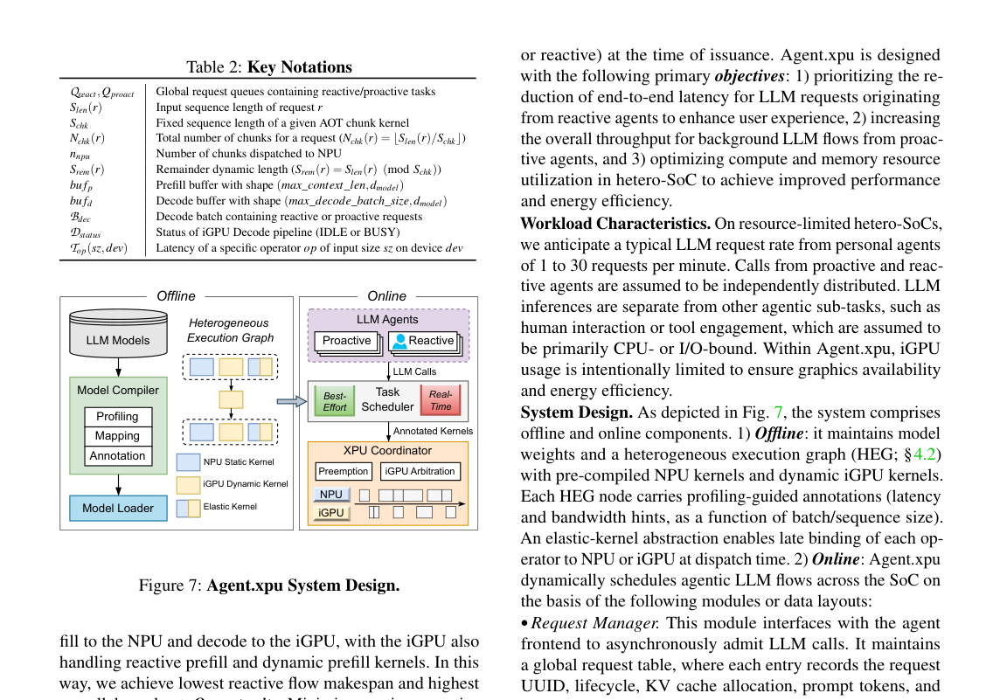
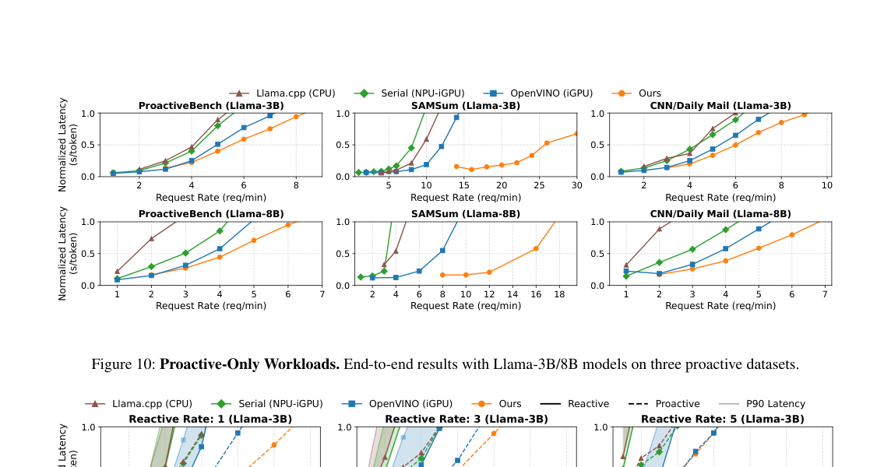
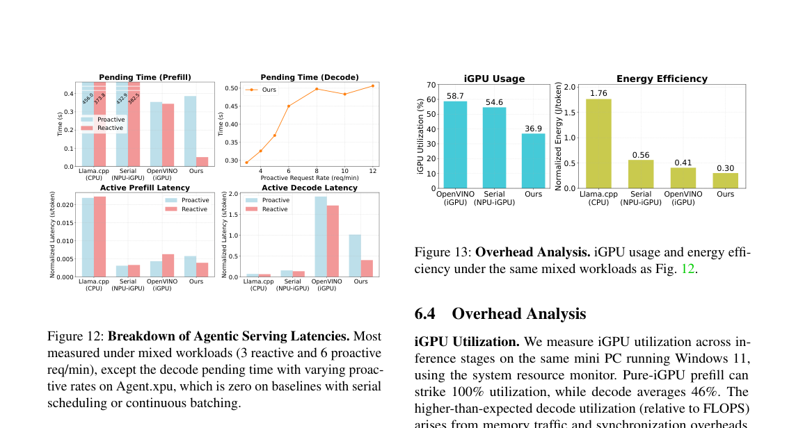

# Agent.xpu

`Agent.xpu` 把用户即时请求定义为 `reactive flow`，把后台监控、整理和总结定义为 `proactive flow`。论文优化两类长生命周期 flow 在共享 `NPU`、iGPU 和 `DDR` 上的响应与吞吐，目标超出单个 prompt latency。

---

## 1. Agent workload 的瓶颈不只在模型

* **测量条件：** 论文面向 personal agent 工作负载。前台请求和后台任务同时运行，共享移动 SoC 的 `NPU`、iGPU 和统一 `DDR`。

* **观测：** `prefill` 和 decode 的 shape、batching 与后端 affinity 不同；`GEMM` 和 `GEMV` 同时执行会竞争 `DDR` 带宽；agent 在工具调用和外部事件等待时存在 slack window。

* **因果：** 后台 flow 如果持续占用加速器，会拉长前台响应。完全串行又会浪费工具等待期间的空闲窗口。

* **设计约束：** 调度器需要区分 `reactive/proactive` 优先级，识别 slack，并支持子图级抢占和设备重绑定。

## 2. Offline graph + online coordinator

图中显示 offline 阶段将模型编译为 heterogeneous execution graph。节点被标注为 `NPU static kernel`、iGPU dynamic kernel 或 elastic kernel，并带有 profiling 代价。online 阶段由 task scheduler 和 XPU coordinator 管理两类 flow。

* **输入与状态：** `reactive flow` 队列、`proactive flow` 队列、heterogeneous execution graph、设备占用状态、slack window、子图依赖。

* **操作：** scheduler 先按 flow 类型和 deadline 排队。coordinator 根据节点 affinity 把子图派发到 `NPU` 或 iGPU。reactive flow 到达时，可抢占或延后 proactive 子图。slack-aware piggybacking 只在不拉长前台响应的窗口执行后台子图。

* **输出与下游：** 前台请求得到更低 pending time，后台任务在空闲窗口继续推进。执行结果按 agent flow 的依赖返回工具调用或下一轮 LLM step。

* **正确性依赖：** preemption 不能打断不可中断子图，也不能破坏 LLM step 的 DAG 依赖。

* **代价与边界：** 需要 runtime 支持细粒度队列、抢占和异构 kernel binding。设备不支持这些能力时，只能退化为粗粒度调度。

核心点是 flow 级调度。`Agent.xpu` 利用 agent 生命周期里的等待窗口，而非固定指定 `prefill` 到 `NPU`、decode 到 iGPU。

## 3. Proactive throughput

论文在真实 personal-agent 工作负载上比较工业级 iGPU-only serving 和静态 `NPU-iGPU` tensor partition。`Agent.xpu` 的 proactive throughput 提升 `1.2-4.9x`，reactive latency 至少降低 `91%`。

图中横轴是 proactive request rate，纵轴是 normalized latency。ProactiveBench、SAMSum、CNN/Daily Mail 上，`Agent.xpu` 在更高请求率下仍保持较低延迟。这个结果对应第 1 节的 slack window：后台吞吐没有依靠长期占满前台关键路径获得。

## 4. Pending time、iGPU usage 和能效

图中左侧分解混合工作负载下的 prefill/decode pending 和 active latency。baseline 的 prefill pending time 更长。右侧显示 `Agent.xpu` 的 iGPU usage 为 `36.9%`，低于 OpenVINO iGPU 的 `58.7%` 和 Serial NPU-iGPU 的 `54.6%`。能耗图使用 normalized energy/token，`Agent.xpu` 为 `0.30`，低于 `llama.cpp` 的 `1.76`、Serial NPU-iGPU 的 `0.56` 和 OpenVINO iGPU 的 `0.41`。

这个结果说明收益来自调度。把所有设备打满会拉长前台 pending time；工具等待和 flow 优先级提供了可利用的空隙。

## 5. 局限

* 系统依赖 SoC 的算子性能、`DDR` 争用模型、runtime 抢占能力和 kernel 编译方式。

* 换芯片后需要重新标注 execution graph 并校准代价。论文未证明同一调度参数可直接迁移到不同厂商 SoC。

* flow 级收益依赖 agent workload 中确实存在 slack window。纯连续对话或无后台任务时，收益会下降。

* 论文关注调度，不直接解决模型量化、attention 精度和外存权重加载。

## 参考文献

1. Xinming Wei et al., "Agent.xpu: Efficient Scheduling of Agentic LLM Workloads on Heterogeneous SoC", arXiv 2025. https://arxiv.org/abs/2506.24045
