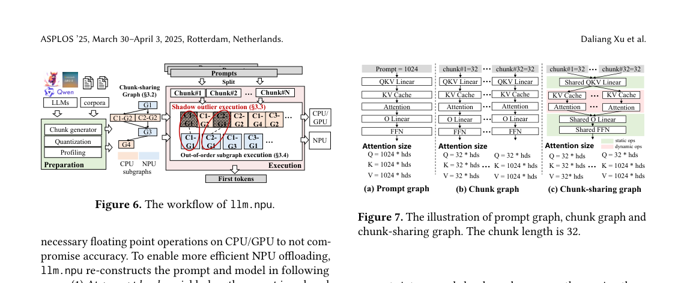
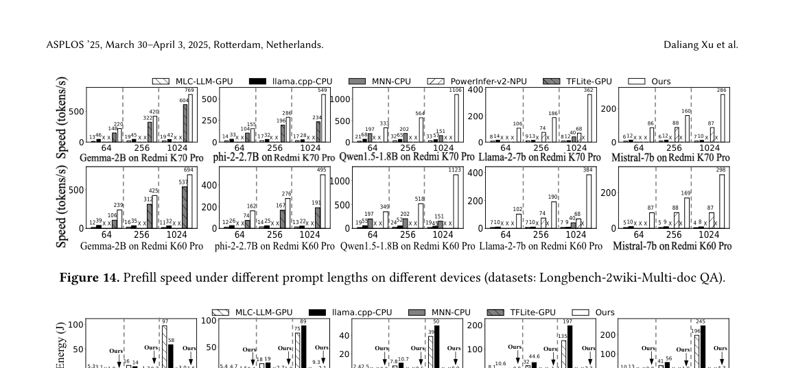

# Fast On-device LLM Inference with NPUs

论文实现 `llm.npu`，目标是让移动 `NPU` 承担 LLM prefill 主计算。方法处理静态图 shape、attention 精度和少量异常值通道，没有把 Transformer 整体直接塞进 `NPU`。

---

## 1. Prefill 不能当作小问题

* **测量条件：** 论文在 UI automation、邮件回复和摘要任务上测移动 `CPU/GPU` 的端到端延迟组成。

* **观测：** 移动 `CPU` 上 prefill 占端到端延迟 `88.3%-98.8%`；移动 `GPU` 上该比例为 `54.2%-91.7%`。

* **因果：** prompt 变长后，大量线性层和 attention 计算集中在 prefill。移动端只优化 decode 不能解决长 prompt 任务。

* **设计约束：** 方法要让 `NPU` 跑 prefill 的大部分矩阵计算，同时避免每个 prompt 长度都重新构建一整张静态图。

## 2. llm.npu 工作流

图中显示 `llm.npu` 的三件事：把 prompt 拆成 chunk，共享稳定的 `QKV/O/FFN` 子图；把异常值路径从 INT8 `NPU` 路径拆出来；在线阶段对可运行子图做乱序调度。

### 2.1 chunk-sharing graph

* **输入与状态：** 不同长度的 prompt、固定大小 chunk、QNN 静态图、每层 `QKV`、`O`、`FFN` 子图。

* **操作：** 系统把长 prompt 切成多个 chunk。能共享 shape 的线性层被编译成可复用静态子图。不同 prompt 长度通过 chunk 组合覆盖，避免为每个长度复制整图。

* **输出与下游：** 编译好的子图进入在线执行队列，由调度器安排 `NPU` 执行。

* **代价与边界：** chunk 太小会增加调度和图管理开销，chunk 太大又降低 shape 覆盖能力。

### 2.2 shadow outlier execution

* **输入与状态：** INT8 量化后的 `NPU` 线性层、少量 high-magnitude channel、`CPU/GPU` 浮点路径。

* **操作：** 常规通道进入 `NPU` INT8 `MatMul`。异常值通道保留到 `CPU/GPU` 浮点路径。两部分结果在后续算子前合并。

* **证据：** 论文统计 `Qwen1.5-1.8B` 时，少于 `3%` 的 channel 贡献超过 `80%` 的异常值。

* **设计含义：** 端到端 INT8 会损伤精度。拆出少量异常值比把整层 attention/linear 回退到浮点更划算。

### 2.3 out-of-order scheduling

* **输入与状态：** 多个 chunk 子图、`NPU` 子图、`CPU/GPU` outlier 子图、依赖 DAG。

* **操作：** 调度器从已经满足依赖的子图中选择能缩短 `NPU` 关键路径的任务，不强制按原始 chunk 顺序执行。

* **输出与下游：** `NPU` 尽量减少等待浮点子图的空洞，最终结果按依赖关系合并。

* **正确性依赖：** 乱序只改变执行顺序，不改变 DAG 依赖和数值合并位置。

## 3. Prefill speed 和准确率

论文在 Xiaomi 14、Redmi K70 Pro 和 Redmi K60 Pro 等移动设备上测试五个移动级模型和四个 LLM benchmark。相对 `CPU` 基线，prefill 速度提高 `7.3x-18.4x`；相对 `GPU` 基线提高 `1.3x-43.6x`；能耗降低 `1.9x-59.5x`。论文还报告相对 FP16 的准确率损失平均约 `1%`。

图中横向比较 prompt length `64/256/1024`、多个模型和 Redmi K70 Pro / Redmi K60 Pro。`llm.npu` 在长 prompt 下仍保持优势，说明 chunk-sharing graph 没有只优化固定 shape。异常值路径也没有把主计算重新拖回 `CPU/GPU`。

## 4. 和 ShadowNPU 的关系

`llm.npu` 主要解决 prefill 线性层和异常值问题。attention 低精度路径仍然敏感。后面的 ShadowNPU 可以看作补上 attention 路径：`NPU` 用低精度估计重要位置，`CPU/GPU` 做最终稀疏 attention。

## 5. 局限

* 系统依赖 QNN 静态图、INT8 kernel 和设备侧子图性能模型。

* 异常值比例会随模型和层变化。少量 channel 拆分在所有模型上是否稳定，需要重新 profiling。

* attention 的高精度路径没有被完全解决。端到端 `NPU-only` 不属于这篇论文的结论。

* 乱序调度收益依赖子图粒度和 runtime 支持。设备不支持细粒度队列时收益会下降。

## 参考文献

1. Daliang Xu et al., "Fast On-device LLM Inference with NPUs", ASPLOS 2025. https://arxiv.org/abs/2407.05858
