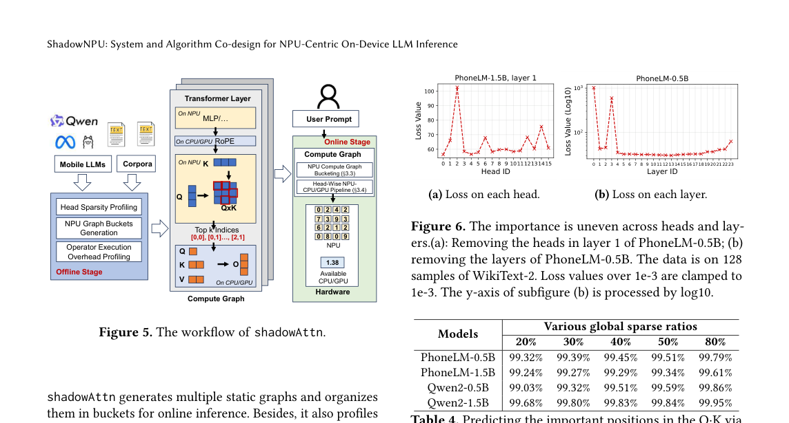
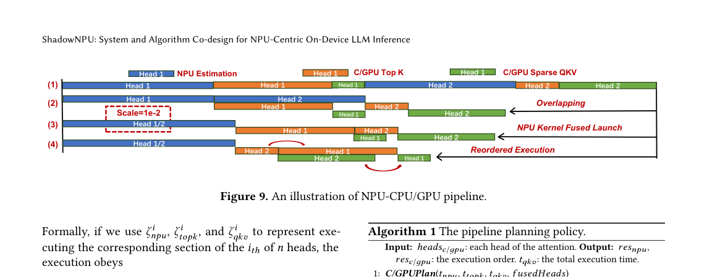
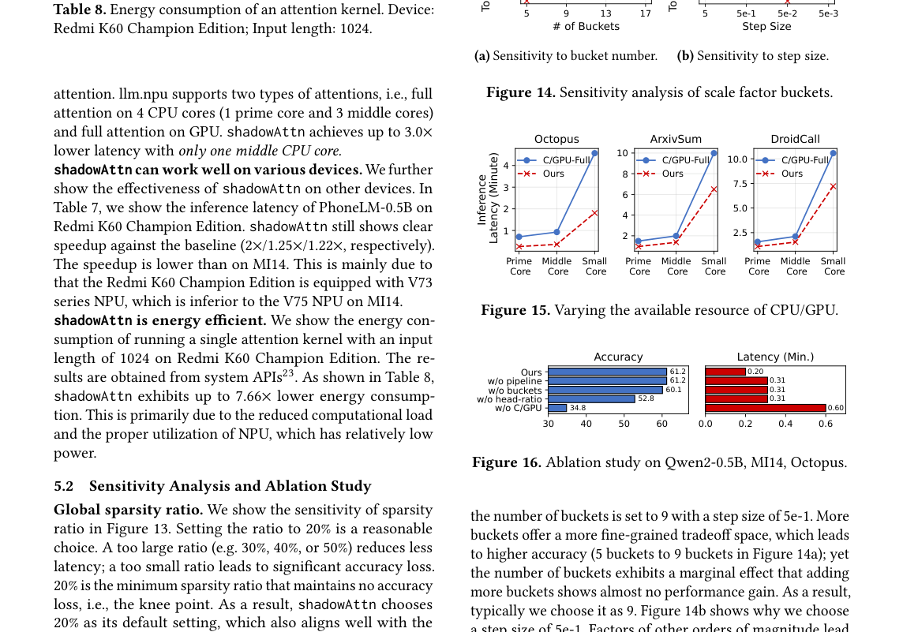

# ShadowNPU

`ShadowNPU` 研究移动 `NPU` 上的 attention 路径。`llm.npu` 已经把大量线性层放到 `NPU`，但 attention 直接低精度量化会损伤准确率。论文提出 `shadowAttn`：`NPU` 先估计重要位置，`CPU/GPU` 再计算稀疏 attention。

---

## 1. Attention 的精度和开销冲突

* **测量条件：** 论文在移动模型和任务上比较 attention 低精度 `NPU` 路径与 `CPU/GPU` 路径。

* **观测：** 将 attention 直接放到 `NPU` 低精度路径，平均有 `18 pp` 的准确率下降。全量 attention 回退到 `CPU/GPU` 又削弱 `NPU-centric` 设计。

* **因果：** `QK` score 对量化误差敏感。移动 `NPU` 的低精度吞吐适合估计，不适合直接承担完整高精度 attention。

* **设计约束：** 方法要让 `NPU` 参与 attention，但不能让低精度 score 直接决定最终输出。`NPU` 适合作 position selector。

attention score 分布具有偏斜性，多数位置不需要进入完整 `QK/V` 计算。问题变成：重要位置估计的开销是否小于被省掉的 attention 计算。

## 2. shadowAttn 的执行路径

图中分为 offline 和 online 两部分。offline 阶段做 head sparsity profiling、`NPU` graph bucket 生成和算子 profiling。online 阶段先执行 `NPU` pilot compute，再把 `Top-k` index 交给 `CPU/GPU`。

* **输入与状态：** 当前 query、历史 `K/V cache`、head-wise sparse ratio、预构建 `NPU` graph bucket、设备 profiling 结果。

* **操作：** `NPU` 用低精度近似 `QK` 得到每个 head 的重要位置排序。系统取 `Top-k` index。`CPU/GPU` 只收集这些位置的 `K/V`，执行最终稀疏 attention。

* **输出与下游：** 稀疏 attention 输出进入后续 projection 和 FFN。`NPU` 的近似 score 不直接成为最终 attention value。

* **正确性依赖：** 低精度估计要保持重要位置 recall。论文在 `WikiText-2` 的 128 个样本上报告多个模型和稀疏率下 recall 约 `99%+`。

* **代价与边界：** 设备间要传递 `Top-k` index 和稀疏 gather metadata。若 head 的 attention 分布不偏斜，稀疏选择收益下降。

核心点是 `NPU` 不负责最终高精度 attention。它负责便宜地找位置，`CPU/GPU` 负责语义上敏感的稀疏计算。

## 3. Head-wise pipeline

图中把每个 head 拆成三段：`NPU` estimate，`CPU/GPU` Top-k，`CPU/GPU` sparse `QKV`。不同 head 的三段可以重叠执行。调度器还会合并 `NPU` kernel launch，减少小 kernel 的启动开销。

* 统一稀疏率会浪费一部分 head，也会伤害长尾 head。论文使用 fine-grained ratio 给不同 head 分配不同保留比例。

* graph bucket 解决移动 `NPU` 对静态 shape 的要求。online 只选择接近当前 shape 的 bucket，避免临时编译新图。

* pipeline 对应的是设备等待问题。若 `NPU` 估计、Top-k 和 sparse compute 串行执行，稀疏 attention 会被同步成本抵消。

## 4. 消融结果

论文报告 `20%` 保留比例是准确率和延迟的拐点。低于该比例会明显损伤准确率，高于该比例减少的 latency 有限。

图中消融 `pipeline`、graph bucket、head-wise ratio 和 `CPU/GPU` 协同。完整方法在图中对应 accuracy `61.2`、latency `0.20 min`；去掉 `CPU/GPU` 协同后 accuracy 降到 `34.8`、latency 到 `0.60 min`。这说明最终稀疏 attention 仍需要高精度后端，`NPU-only` 路径在该设置下不可行。

论文还报告 attention kernel 输入长度为 `1024` 时能量最高降低 `7.66x`。该结果对应第 1 节的瓶颈：全量 `CPU/GPU` attention 太贵，直接低精度 `NPU` attention 又不准。

## 5. 局限

* 方法依赖 attention score 的偏斜性。长上下文、检索增强任务或异常 head 可能降低重要位置 recall。

* `Top-k` index、稀疏 gather 和设备同步会形成额外开销。短序列或小模型上收益可能被同步抵消。

* graph bucket 与移动 `NPU` runtime 绑定。换设备后要重新 profiling shape、kernel launch 和 sparse ratio。

* 论文解决 attention 路径，不直接处理 FFN 权重放不下、`KV cache` 容量和多请求调度。

## 参考文献

1. Wangsong Yin et al., "ShadowNPU: System and Algorithm Co-design for NPU-Centric On-Device LLM Inference", arXiv 2025. https://arxiv.org/abs/2508.16703
