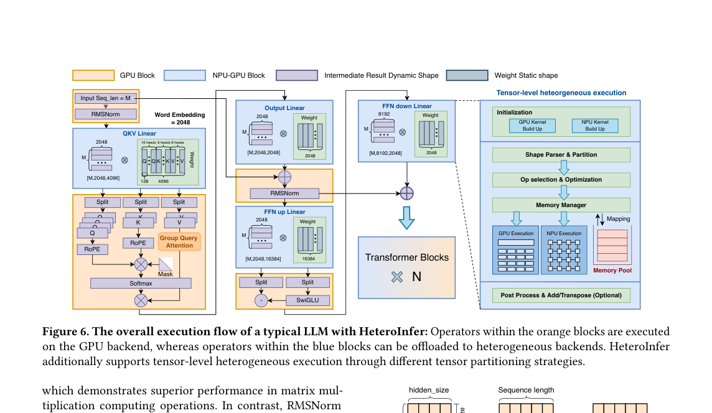
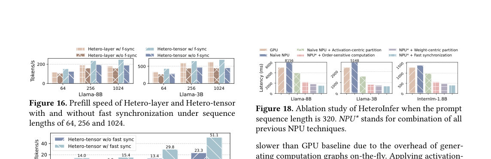
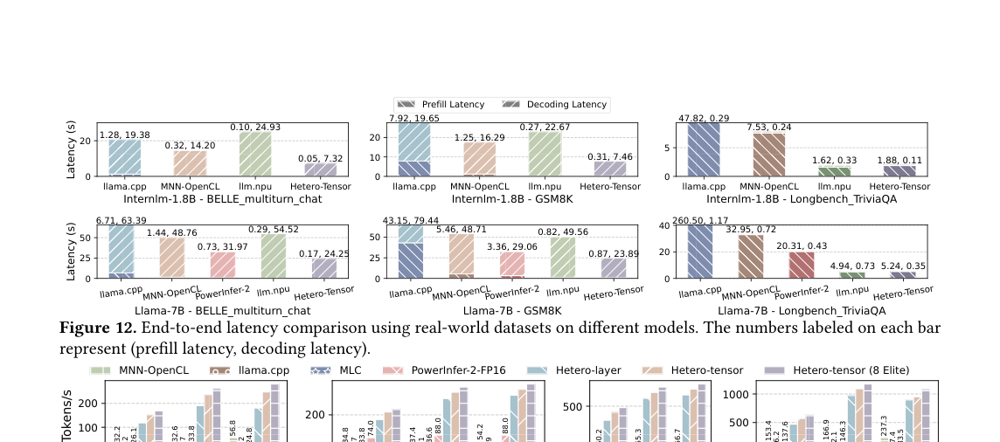

# HeteroLLM

`HeteroLLM` 先刻画移动 SoC 中 `GPU`、`NPU` 与统一内存的性能差异，再提出 `HeteroInfer`。论文的判断是：单一 accelerator 不能同时覆盖 prefill 的矩阵吞吐和 decode 的带宽约束。

---

## 1. 设备差异不能简化成谁更快

* **测量条件：** 论文关注移动 SoC，设备包括移动 `GPU`、`NPU` 和 unified memory。工作负载分为 prefill 和 decode。

* **观测：** `GPU` 性能随 tensor size 增长较平滑；`NPU` 对 tensor order、shape 和算子支持更敏感。统一内存减少复制，但 `GPU-NPU` 同步、切分和合并仍会拉长关键路径。

* **因果：** prefill 是大矩阵吞吐问题，decode 更接近 memory-bound `GEMV`。固定后端无法同时适配两类阶段。

* **设计约束：** 方法要按 layer 或 tensor 级别选择后端，并把同步成本纳入 solver。平均切层会忽略 shape 和同步差异。

## 2. HeteroInfer 的切分路径

图中左侧标出 Transformer block 的执行位置。橙色块在 `GPU`，蓝色块可进入 `NPU-GPU` 异构路径。右侧显示 tensor-level heterogeneous execution pipeline：kernel build、shape parser、partition、op selection、memory manager、`GPU/NPU` execution、memory pool mapping 和 post-process。

* **输入与状态：** 当前层的 activation、权重 tensor、tensor shape、设备 profiling 表、统一内存中的 buffer。

* **操作：** solver 先判断完整 layer 是否适合某个后端。若 layer-level 不够，继续拆 `QKV`、`O`、`FFN up/down` 等 tensor。partition 可以按 weight-centric、activation-centric 或 hybrid strategy 选择切分边界。

* **输出与下游：** `GPU/NPU` 子结果在 memory pool 中合并，必要时执行 add、transpose 或 post-process，再交给下一层。

* **正确性依赖：** tensor-level 切分必须保持矩阵乘法的维度和累加语义。同步只改变执行并行度，不改变算子结果。

* **代价与边界：** 切分太细会增加 kernel launch、同步和合并；切分太粗会错过 `NPU` 对特定 shape 的优势。

这篇论文把“异构”落到具体 tensor 边界。只写 `GPU/NPU 协同` 不能解释收益，必须写清哪个矩阵在哪个设备上跑，结果在哪里合并。

## 3. Fast synchronization 是方法的一部分

统一内存让 `GPU` 和 `NPU` 不需要显式大规模复制，但它不等于零同步。`HeteroInfer` 的 fast synchronization 负责管理设备交接和 memory pool 映射，减少一侧等待另一侧结果的时间。

图中显示 Hetero-layer 和 Hetero-tensor 在 sequence length `64/256/1024` 下使用 fast synchronization 后 prefill speed 均提高。消融图还显示 order-sensitive computation 和 fast synchronization 共同降低 latency。同步机制会决定异构切分能否成立。

## 4. 实验结果

论文在 `Galaxy S24 Ultra` 上测试真实数据集。`InternLM-1.8B` 上 prefill 达到 `1092 token/s`。decode-heavy 的 `Llama-7B` 任务中，Hetero-tensor 相对 MNN 和 `llm.npu` 的加速分别为 `2.06x` 与 `3.40x`。

图中将 prefill 与 decode latency 分开标注。`Llama-7B` 的 `GSM8K` 场景中，Hetero-tensor 约为 `0.87s` prefill / `23.89s` decode，`llama.cpp` 约为 `43.15s` prefill / `79.44s` decode。这个对比说明异构收益主要来自阶段和 shape 对齐，简单堆更多设备不能得到同样结果。

## 5. 局限

* 性能模型绑定 SoC 的 `NPU` shape 约束、`GPU` kernel 和内存行为。

* 新模型或新芯片需要重新 profiling。solver 的选择不能脱离硬件表。

* tensor-level 切分对 runtime 要求高。设备不支持细粒度同步和 memory pool 管理时，收益会下降。

* 论文主要处理单设备 SoC 内的异构执行。多请求 serving、thermal throttling 和外存权重加载不属于核心对象。

## 参考文献

1. Le Chen et al., "Characterizing Mobile SoC for Accelerating Heterogeneous LLM Inference", arXiv 2025. https://arxiv.org/abs/2501.14794
