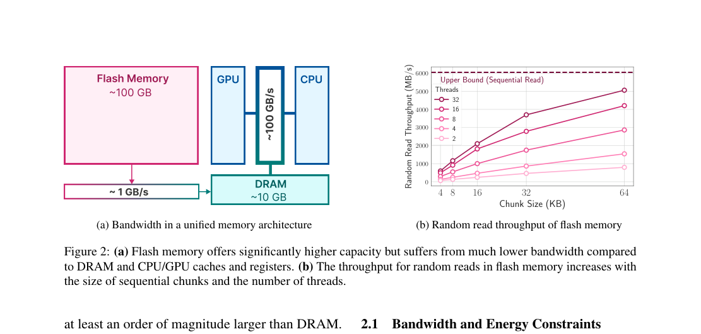
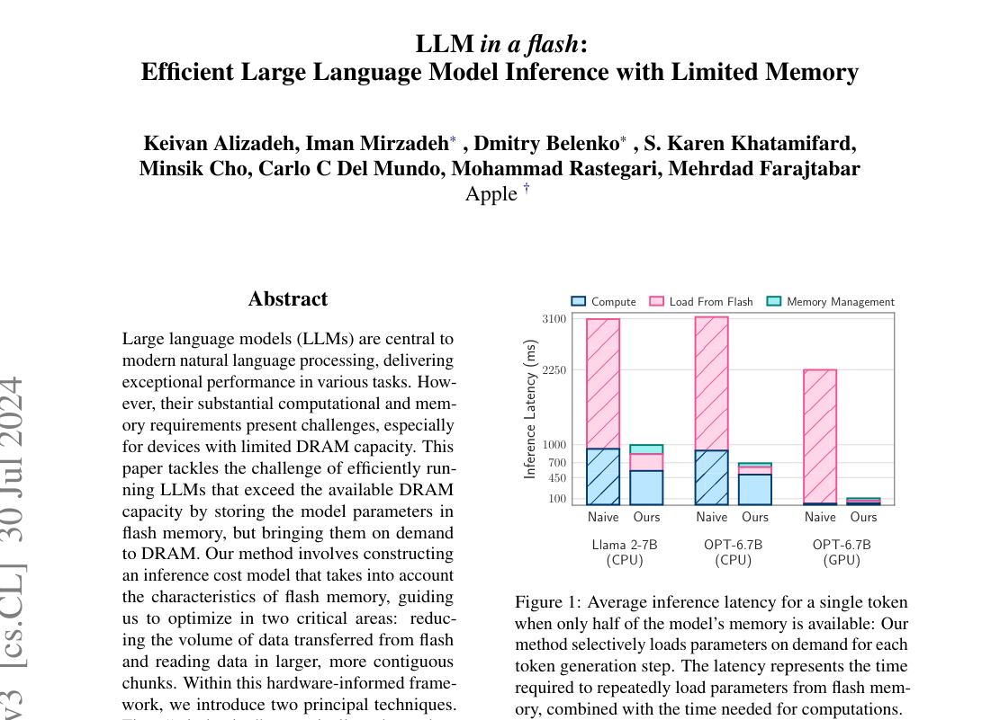

# LLM in a Flash

论文关注 `DRAM` 小于模型权重的端侧推理。关键问题是 decode 每生成一个 `token` 都可能把 FFN 权重从 `flash` 搬到 `DRAM`，权重 I/O 进入关键路径。

---

## 1. 外存带宽决定下限

* **测量条件：** 论文讨论统一内存设备上的 `flash`、`DRAM`、`CPU/GPU` 缓存与寄存器。目标设定是可用 `DRAM` 约为模型容量一半。

* **观测：** `flash` 容量约 `100 GB`，`DRAM` 容量约 `10 GB`。`flash -> DRAM` 带宽约 `1 GB/s`，`DRAM -> CPU/GPU` 路径约 `100 GB/s`。右图显示随机读取吞吐随 chunk size 和线程数上升。

* **因果：** 权重不能常驻 `DRAM` 时，decode 会等待 `flash` I/O。随机小块读取降低吞吐。后端计算越快，等待外存的比例越高。

* **设计约束：** 方法要减少读取量，也要把读取变成更大的连续块。只按神经元级别读取最少权重会制造随机 I/O。

图中给出这篇工作的硬边界：`flash` 适合容量，不适合细粒度随机访问。后面的 `windowing` 和 `row-column bundling` 都服务于同一个目标：把神经元级访问改成存储友好的块访问。

## 2. 激活预测和权重读取绑定

论文利用 FFN 激活稀疏性。每个 decode step 不加载全部 FFN 权重，只加载预测会激活的神经元相关权重。

* **输入与状态：** 当前 `token` 的 hidden state、常驻内存中的 attention/embedding/部分状态、`flash` 中的 FFN 权重、最近 token 的激活历史。

* **执行流程：** predictor 先估计当前 step 可能激活的 FFN 神经元。系统查询 `DRAM` 权重缓存。缺失权重从 `flash` 读入 `DRAM`。`windowing` 复用最近 token 的激活权重。`row-column bundling` 把离散行列打包为连续读取块。

* **输出与下游：** FFN 权重进入 `DRAM` 后由 `CPU/Metal/GPU` 后端执行计算，输出 hidden state 进入后续 Transformer 层。

* **正确性依赖：** predictor 不能漏掉对输出影响大的神经元。预测冗余增加 I/O，预测遗漏改变模型输出。

* **代价与边界：** 方法增加 predictor、缓存管理和 bundle 选择开销。激活稀疏性弱或 `flash` 随机读性能差时，收益下降。

核心点是把“加载哪些权重”和“怎么从 `flash` 读取”放在同一个 cost model 里。只做稀疏预测会产生随机 I/O；只做块读取会加载过多无用权重。

## 3. 单 token 延迟分解

图中比较 `Llama 2-7B`、`OPT-6.7B` 在 `CPU` 和 `GPU` 后端的单 token 延迟。纵轴是 inference latency，颜色区分 compute、load from flash 和 memory management。

* naive 路径的主要时间来自 `Load From Flash`。

* 论文方法同时降低 `CPU` 和 `GPU` 后端的 flash load 时间。

* `OPT-6.7B` 的 `GPU` 路径中 compute 占比小，naive 延迟主要被 flash load 占满。优化后延迟下降更明显。

论文报告在可用 `DRAM` 约为模型容量一半时，相对 naive loading，`CPU`、`Metal` 和 `NVIDIA GPU` 后端最高加速分别为 `4x`、`7x` 和 `20x`。该结果说明瓶颈主要在权重传输路径。

## 4. 和端侧部署的关系

这篇论文适合看作 PowerInfer-2 的前置问题：外存权重加载必须和稀疏执行一起设计。

* `flash` 路径的关键指标是吞吐、chunk size、线程数和预取命中率。

* 稀疏预测的关键指标是漏召回率和冗余读取量。

* 端侧 runtime 的关键指标是缓存替换、I/O 与计算重叠、后端执行速度。

## 5. 局限

* predictor 依赖模型和输入分布。长上下文、任务切换或稀疏结构变化会改变神经元激活模式。

* `row-column bundling` 绑定存储介质。不同 `SSD/UFS/flash` 的随机读曲线不同，bundle 大小需要重新校准。

* 论文主要讨论 FFN 权重路径。`KV cache` 容量、attention 计算和多请求调度不是这篇工作的主要对象。

## 参考文献

1. Keivan Alizadeh et al., "LLM in a Flash: Efficient Large Language Model Inference with Limited Memory", arXiv 2023. https://arxiv.org/abs/2312.11514
