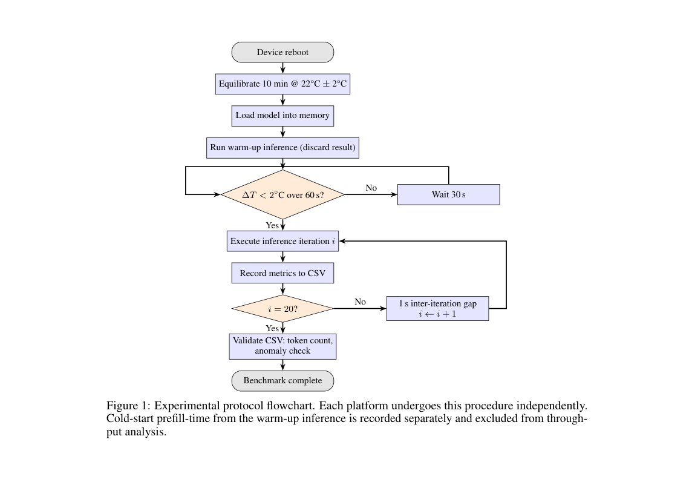
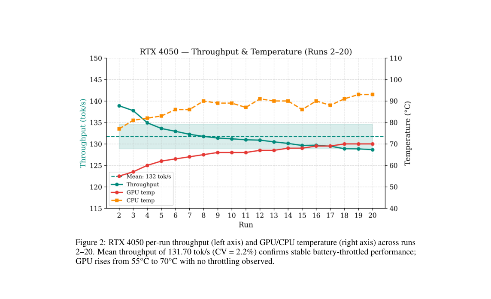
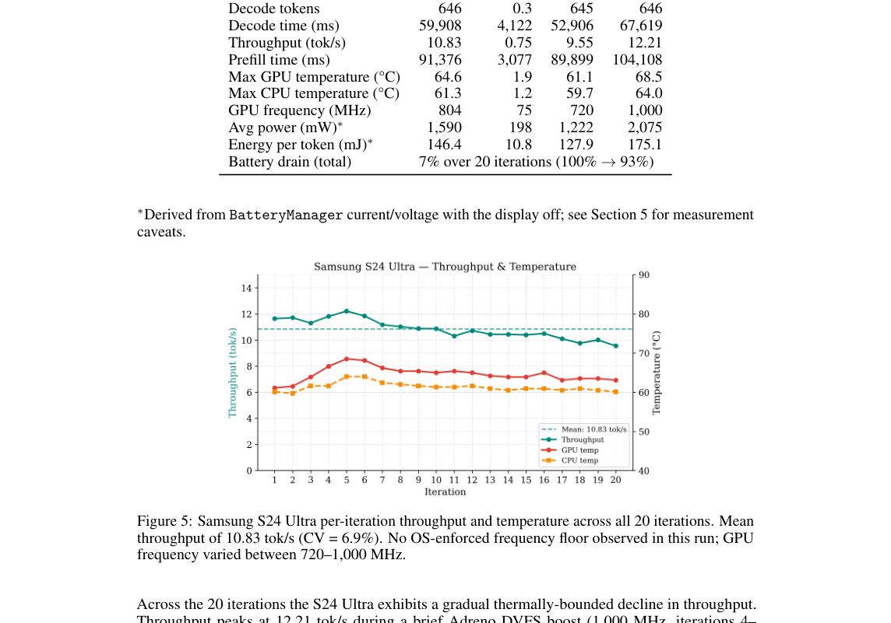

# LLM Inference at the Edge

这篇 benchmark 不把单次 latency 当作端侧部署结论。论文在 warm-condition 下连续运行，记录吞吐、功耗和温度，观察热管理如何改变持续 `token/s`。

---

## 1. 评测协议本身是方法

论文使用 `Qwen 2.5 1.5B` 4-bit 模型，在 `Raspberry Pi 5 + Hailo-10H`、`Galaxy S24 Ultra`、`iPhone 16 Pro` 和 `RTX 4050` 上比较。输入固定为 258 token，贪心解码，设备各执行 20 次 warm-condition iteration。

图中显示完整流程：reboot，22°C ± 2°C 环境下静置 10 分钟，加载模型，warm-up inference，等待 60 秒内温度变化小于 `2°C`，再执行 20 次正式测量。每轮之间保留 1 秒间隔，最后校验 CSV 的 token 数和异常值。

* **测量条件：** 固定模型、量化、prompt、解码策略和环境温度。

* **观测对象：** steady-state throughput、CPU/GPU/NPU 温度、功耗、电池消耗和 token 计数。

* **因果问题：** cold run 只反映加载和初始热状态。长时间端侧 agent 关心的是散热稳定后的吞吐。

* **设计约束：** benchmark 要把 cold-start prefill 单独记录，并从持续吞吐统计中剔除。

## 2. RTX 4050：持续吞吐稳定

图中显示 `RTX 4050` 在第 2 至 20 次运行中平均为 `131.70 tok/s`，变异系数 `2.2%`。GPU 温度从约 `55°C` 上升到 `70°C`，但没有触发明显 throttling。

这个结果说明桌面级独显的持续吞吐可以接近 warm-state 峰值。限制更接近 power ceiling 或框架吞吐，手机式快速热衰减不是主要现象。

## 3. Galaxy S24 Ultra：峰值不能代表长期速度

图中显示 `Galaxy S24 Ultra` 的吞吐在前几轮后下降，并在约 `10.83 tok/s` 附近波动。论文表格报告 646 个 decode token、约 `59.9s` decode time、最高 GPU 温度 `64.6°C`，20 次迭代约消耗 `7%` 电量。

这个曲线比单次峰值更接近本地 agent 的真实可用速度。手机端主要受 thermal management 和功耗策略约束，标称 TOPS 不足以预测持续吞吐。

## 4. 平台排序依赖约束类型

* `RTX 4050` 的第 2 至 20 次平均吞吐为 `131.70 tok/s`，CV 为 `2.2%`。

* 论文平台汇总表报告 `Hailo-10H` 的吞吐约为 `6.9 tok/s`，温度曲线稳定，主要受 memory bandwidth 约束。

* 论文平台汇总表报告 `iPhone 16 Pro` 在前三次内损失约 `40%` 峰值吞吐，随后在 hot state 附近稳定到约 `23.7 tok/s`。

* `Galaxy S24 Ultra` 在 20 次运行中下降约 `15%`，稳定区间约为 `10 tok/s`。

论文的结论是持续吞吐必须附带模型、量化、prompt、上下文窗口、环境温度和散热条件。脱离这些条件的平台排序没有意义。

## 5. 对端侧 agent 的意义

如果 agent 需要连续执行规划、工具调用和总结，单次 decode latency 不够用。更应该记录：

* warm-state `token/s`；

* 20 次或更长窗口的变异系数；

* 温度和频率曲线；

* 电池消耗；

* cold-start 是否计入用户可见延迟。

这篇论文更像评测协议参考。它不提出新的推理 kernel，但它约束了端侧优化论文该怎么报结果。

## 6. 局限

* 实验只覆盖一个 `Qwen 2.5 1.5B` 4-bit 模型和固定 258-token prompt。

* 输出长度、上下文长度、量化格式和 runtime 版本都会改变平台排序。

* 环境温度和散热条件对手机结果影响很大。不同手机壳、充电状态和后台进程都可能改变曲线。

* 论文主要是单模型持续推理，不覆盖多 agent flow 调度和前后台任务抢占。

## 参考文献

1. Pranay Tummalapalli et al., "LLM Inference at the Edge: Mobile, NPU, and GPU Performance Efficiency Trade-offs Under Sustained Load", arXiv 2026. https://arxiv.org/abs/2603.23640
