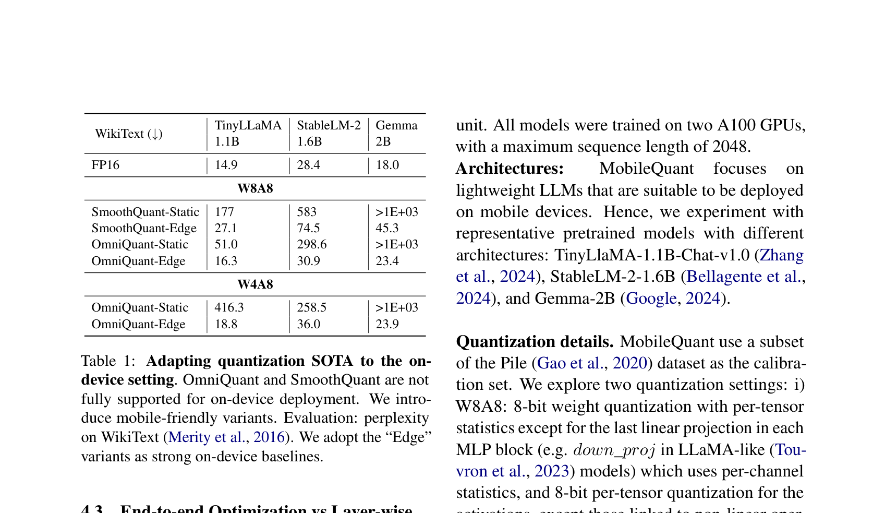
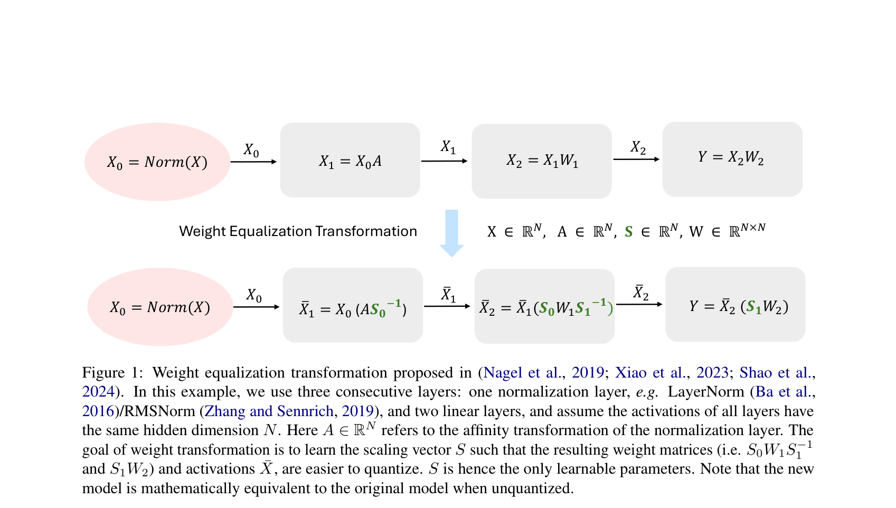
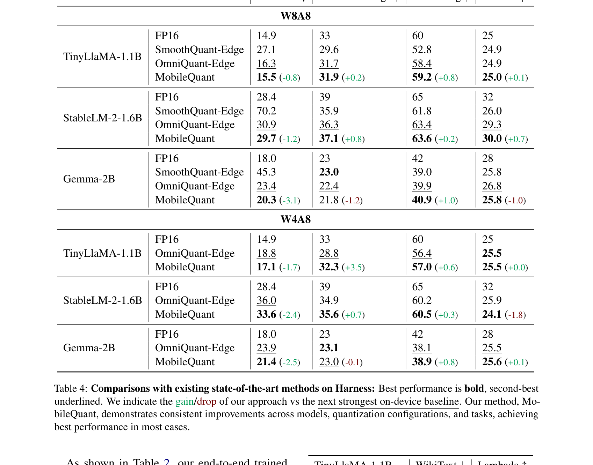
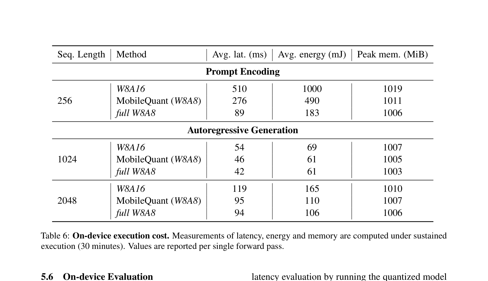

# MobileQuant: Mobile-friendly Quantization for On-device Language Models

论文关注端侧 LLM 的 weight-activation quantization。核心问题是：weight-only 量化可以省模型存储，但计算仍然走高精度路径；动态 activation quantization 在 GPU 上可用，在移动 `NPU/DSP` 上缺少硬件支持。`MobileQuant` 的目标是把 LLM 的大部分线性计算落到移动端友好的 integer-only 路径上。

## 1. 动机：端侧需要静态 W/A 量化

- **测量条件：** 论文面向 Samsung Galaxy S24，使用 Snapdragon 8 Gen 3 HTP 作为 compute unit。模型覆盖 TinyLLaMA-1.1B-Chat-v1.0、StableLM-2-1.6B、Gemma-2B。训练和量化模拟在两张 A100 上完成，最大序列长度为 `2048`。
- **观测：** 移动端硬件广泛支持 `int8-int8` fixed-point 运算，通常也支持 `int4-int16` 和 `int8-int16`，但动态 per-token activation quantization 不属于常规移动端支持路径。
- **因果：** weight-only 方法仍需要 on-the-fly dequantization 和浮点计算；动态 activation 方法需要输入相关的在线 range 统计。两者都难直接映射到移动 `NPU/DSP`。
- **设计约束：** 方法需要使用静态 per-tensor/per-channel range，并让 activation 尽量进入 `8-bit`，同时保留非线性算子附近的高精度路径，避免全 W8A8 精度崩掉。

论文先把 SmoothQuant 和 OmniQuant 改成移动端可部署版本，再显示原始方法直接改静态 activation 后会失效。

图中测量的是 WikiText perplexity。`SmoothQuant-Static` 在 TinyLLaMA/StableLM/Gemma 上分别变成 `177/583/>1E+03`，`OmniQuant-Static` 在 W4A8 下也出现 `416.3/258.5/>1E+03`。加入端侧适配后，`OmniQuant-Edge` W8A8 分别降到 `16.3/30.9/23.4`。这个表把瓶颈定位到 activation range 和移动端硬件支持约束之间的冲突。

## 2. 方法：把等价变换和 activation range 一起学

`MobileQuant` 继承 weight equivalent transformation 的思路。给定线性层

$$Y = XW = (XS^{-1})(SW) = \hat{X}\hat{W}$$

其中 $X$ 是输入 activation，$W$ 是线性层权重，$S$ 是按通道的缩放向量。缩放可以被融合进相邻线性层，所以未量化时模型输出与原模型数学等价。量化时，目标是让 $\hat{X}$ 和 $\hat{W}$ 的分布更适合低比特表示。

图中显示三个连续层的变换：归一化层的 affine 参数、第一层线性层和第二层线性层之间插入 $S_0$、$S_1$。输入状态 $X_0$ 经过归一化和线性层后，缩放向量被吸收到相邻权重中。输出状态仍由后续线性层消费，未量化路径保持等价。

### 2.1 端侧适配

- **输入与状态：** 校准集来自 Pile 子集。每层有 weight equalization 参数、weight clipping 参数和 activation quantization range 参数。
- **操作：** 方法在所有可传播的连续线性组件之间使用等价变换。遇到 `Softmax`、`RMSNorm`、`LayerNorm`、`SiLU/GELU` 这类非线性边界时，非线性 activation 保留 `16-bit integer`。
- **输出与下游：** 线性层权重进入 `W8A8` 或 `W4A8` 配置。activation 主要使用 `8-bit per-tensor static quantization`，权重使用 per-tensor 或 per-channel quantization。
- **依赖与正确性：** 等价变换保证未量化模型和原模型数学等价；量化误差来自低比特离散化，不来自结构改写。
- **代价与边界：** 方法需要校准样本和训练 epoch。它不是纯 closed-form PTQ；同时非线性算子附近仍保留 16-bit activation。

### 2.2 Activation Range Learning

activation 分布会随着 weight transformation 变化。固定 min/max range 会让 OmniQuant 这类学习式方法在每轮训练后面对过期 range。`MobileQuant` 不直接学习 $f_{min}(X)$ 和 $f_{max}(X)$，而是学习量化的 scale 与 offset：

$$q_{max}=2^{bw}-1$$

$$\alpha = \frac{f_{max}-f_{min}}{q_{max}},\quad \beta=\frac{f_{min}}{\alpha}$$

其中 $bw$ 是目标 bit-width，$\alpha$ 是量化 scale，$\beta$ 是 offset。训练时通过 straight-through estimator 传播梯度。这样每层 activation range 可以和 weight transformation 一起更新。

### 2.3 End-to-end Optimization

论文把所有层的 $S$、weight clipping 和 activation range 参数放到同一个 end-to-end 目标下优化。Table 2 显示，在 OmniQuant-Edge W4A8 设置下，block-wise 方法增加样本和 epoch 后会饱和；end-to-end 方法在更大训练设置下继续变好。例如 Gemma-2B 在 `1024 samples / 60 epochs` 时，block-wise WikiText perplexity 为 `24.9`，end-to-end 为 `21.4`。

## 3. 精度结果：W8A8 接近强端侧 baseline

论文在 Harness 里做 zero-shot 评测，任务包括 WikiText、ARC-Challenge、HellaSwag 和 MMLU。MobileQuant 和移动端适配后的 SmoothQuant/OmniQuant 比较。

图中 W8A8 设置下，TinyLLaMA-1.1B 的 WikiText perplexity 从 `OmniQuant-Edge 16.3` 降到 `15.5`，HellaSwag 从 `58.4` 到 `59.2`。StableLM-2-1.6B 的 WikiText 从 `30.9` 到 `29.7`，MMLU 从 `29.3` 到 `30.0`。W4A8 设置下，TinyLLaMA 的 WikiText 从 `18.8` 到 `17.1`，ARC-Challenge 从 `28.8` 到 `32.3`。

论文还在设备上测 TinyLLaMA-1.1B-Chat-v1.0 的 accuracy。`W8A16` 在 WikiText/LAMBADA 上为 `15.2/82.9`，`MobileQuant W8A8` 为 `15.6/82.4`，而 full W8A8 退化到 `8e5/1.3`。这个结果说明，直接把所有 activation 都压到 8-bit 会破坏模型；MobileQuant 的非线性边界和 range 学习是必要条件。

## 4. 端侧代价：latency 和 energy 都下降

端侧实验使用 Samsung Galaxy S24 和 Snapdragon 8 Gen 3 HTP。论文报告 sustained execution `30 minutes` 下的单次 forward latency、energy 和 peak memory。

图中 prompt encoding 的 sequence length 是 `256`。`W8A16` latency 为 `510ms`、energy 为 `1000mJ`；`MobileQuant W8A8` 降到 `276ms` 和 `490mJ`；full W8A8 是 `89ms` 和 `183mJ`，但上一节已经显示 full W8A8 精度崩掉。

autoregressive generation 的收益更小。sequence length `1024` 时，`W8A16` 为 `54ms/69mJ`，MobileQuant 为 `46ms/61mJ`；sequence length `2048` 时，`W8A16` 为 `119ms/165mJ`，MobileQuant 为 `95ms/110mJ`。论文判断 decode 阶段对轻量模型不完全 compute-bound，部分瓶颈来自 memory access，所以低比特 activation 的收益小于 prompt encoding。

## 5. 位置和局限

- **和 SmoothQuant 的关系：** SmoothQuant 已经使用等价变换迁移 activation 难度，但原始设计主要面向 GPU/server，端侧静态 activation range 后会出现明显退化。MobileQuant 把范围学习和端侧可支持的 bitwidth/group/static 约束一起放入设计。
- **和 OmniQuant 的关系：** OmniQuant 的 block-wise error minimization 在小校准预算下有效，但增加样本和 epoch 后收益饱和。MobileQuant 的 end-to-end 优化在表 2 中随训练规模继续改善。
- **硬件边界：** 论文的真实设备实验只覆盖 TinyLLaMA-1.1B-Chat-v1.0 和 Snapdragon 8 Gen 3 HTP。更大模型、不同 NPU compiler、不同非线性算子支持情况都需要重新验证。
- **方法边界：** 非线性算子附近仍保留 16-bit activation。MobileQuant 不是完整 full W8A8；它是在精度和移动端 integer kernel 可用性之间做工程折中。

## 参考文献

1. Fuwen Tan et al., "MobileQuant: Mobile-friendly Quantization for On-device Language Models", Findings of EMNLP 2024, https://arxiv.org/abs/2408.13933
