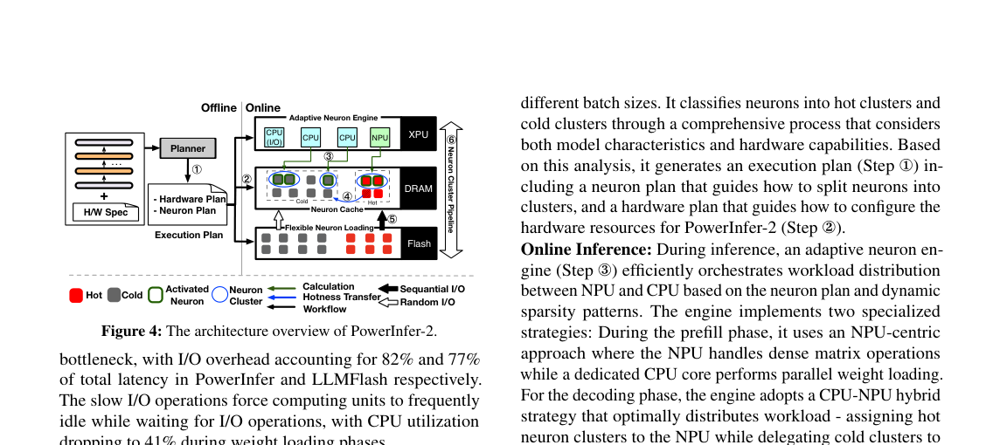
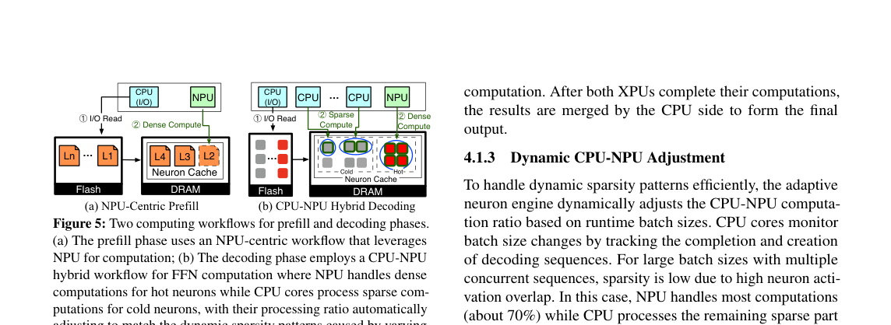
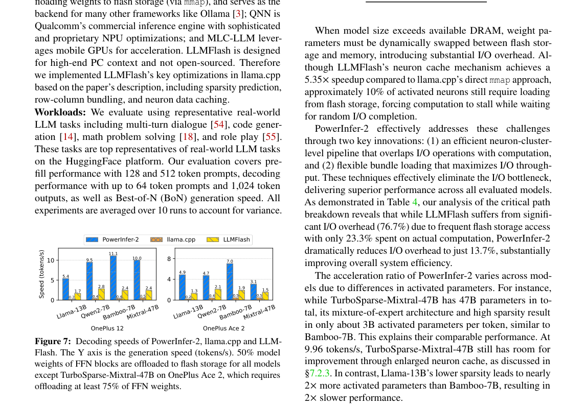

# PowerInfer-2

`PowerInfer-2` 研究智能手机上的稀疏大模型推理。论文的出发点是：移动 `NPU` 适合规则密集计算，`CPU` 能处理不规则稀疏路径，`UFS/flash` 负责承载放不进 `DRAM` 的权重。三者必须按同一个调度粒度组织。

---

## 1. 单神经元稀疏不适合手机

* **测量条件：** 目标设备是智能手机，权重存储在 `UFS/flash`，计算设备包括 `CPU` 和移动 `NPU`。目标模型可以大于可用内存。

* **观测：** decode 中 I/O 在 PowerInfer 和 LLMFlash 的总延迟占比分别达到 `82%` 和 `77%`。稀疏计算本身不能解释全部延迟。

* **因果：** 单神经元粒度会产生不规则访存和随机读取。移动 `NPU` 对这种稀疏模式不友好，`UFS` 也不适合频繁小块读取。

* **设计约束：** 方法需要把稀疏粒度放大到 `neuron cluster`，让权重读取、缓存命中和 `CPU/NPU` 分工可以一起优化。

## 2. 离线 plan 和在线 adaptive engine

图中显示系统分为 offline 和 online 两部分。offline 阶段读取硬件规格和神经元激活模式，生成 execution plan。online 阶段的 adaptive neuron engine 根据 plan 调度 hot/cold cluster。

* **输入与状态：** 模型权重、硬件规格、神经元激活 profile、`DRAM` 中的 cluster cache、`flash` 中的冷权重。

* **操作：** planner 将神经元合并为 cluster，并标注 hot/cold 属性。hot cluster 尽量留在 `DRAM`。在线推理时，dense/hot 路径进入 `NPU`，cold sparse 路径由 `CPU` 和 `flash` 加载承担。

* **输出与下游：** 每层 FFN 的 cluster 计算结果重新合并为 hidden state，进入下一层 Transformer。

* **依赖与正确性：** cluster 选择必须覆盖当前 token 激活的神经元。cache 命中只影响速度，漏算活跃 cluster 会改变输出。

* **代价与边界：** plan 绑定设备和模型分布。热度转移、缓存替换和预取错误会降低收益。

核心点是调度粒度从 neuron 变为 `neuron cluster`。这个粒度足够大，可以让 `NPU` 做规则计算，也能让 `flash` 读取更接近块访问。

## 3. Prefill 和 decode 使用不同路径

图中把两个阶段分开。prefill 的输入 token 多，矩阵计算更密集；decode 每步只处理一个新 token，权重读取和稀疏激活更突出。

* **prefill：** 系统按 layer 从 `flash` 读取权重，主要交给 `NPU` 执行 dense computation。该阶段利用 `NPU` 的矩阵吞吐。

* **decode：** 系统按 cluster 读取 sparse weights。hot/dense cluster 进入 `NPU`，cold/sparse cluster 进入 `CPU` 路径。`flash -> DRAM` 的加载与 `CPU/NPU` 计算重叠。

* **设备边界：** `flash` 提供权重块，`DRAM` 承载 cache 和中间状态，`NPU` 处理规则 dense/hot cluster，`CPU` 处理不规则 cold sparse cluster。

* **证据映射：** 这一设计对应第 1 节的 I/O 占比观测。decode 如果只做稀疏计算，不处理 `flash` 读取，关键路径仍被 I/O 占据。

## 4. 解码速度

论文报告相对已有框架最高加速 `27.8x`，并在 `OnePlus 12` 上以 `11.68 tokens/s` 运行 `47B` 模型。

图中比较 OnePlus 12 和 OnePlus Ace 2 上多个模型的 decode speed。PowerInfer-2 在多数组合中高于 `llama.cpp` 和 LLMFlash。OnePlus 12 上，PowerInfer-2 对 `Llama-13B` 约为 `5.4 tok/s`，`Qwen-72B` 约为 `9.5 tok/s`，`Bamboo-7B` 约为 `11.1 tok/s`，`Mixtral-47B` 约为 `10.0 tok/s`。收益随模型和设备变化。

这个实验不应只读成“稀疏带来加速”。更准确的结论是：cluster 粒度让稀疏计算、缓存命中和外存读取可以进入同一个流水线。

## 5. 局限

* cluster 划分依赖神经元激活分布。任务分布变化会造成 hot cluster 迁移，cache 命中率下降。

* `NPU` 的 shape 支持、`UFS` 随机读性能和 `DRAM` 容量都会改变最优 plan。

* 论文方法需要离线 profiling。换模型或换手机后，不能直接复用同一执行计划。

* 该方法主要优化 FFN 稀疏路径。attention、`KV cache` 和多请求调度仍需要其他系统层设计。

## 参考文献

1. Zhenliang Xue et al., "PowerInfer-2: Fast Large Language Model Inference on a Smartphone", arXiv 2024. https://arxiv.org/abs/2406.06282
