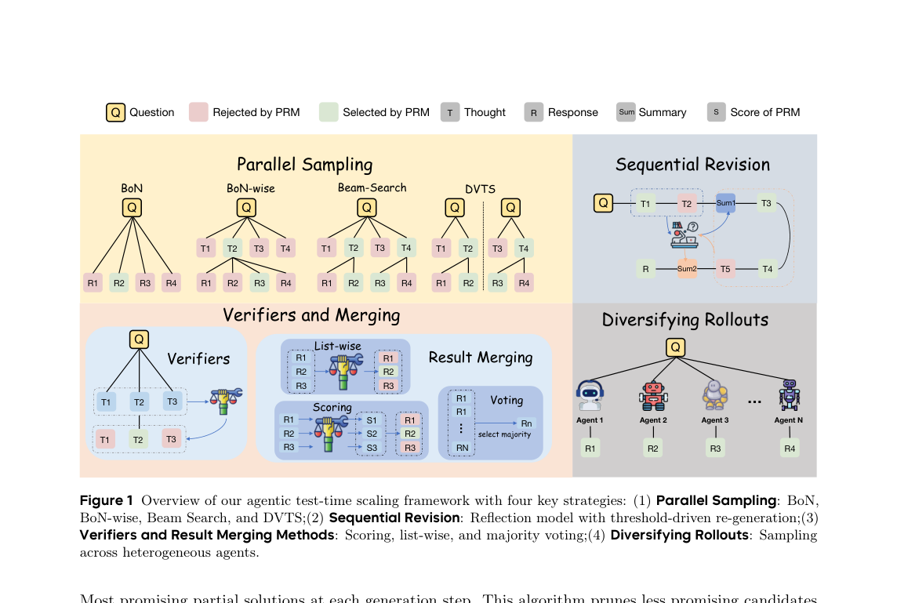
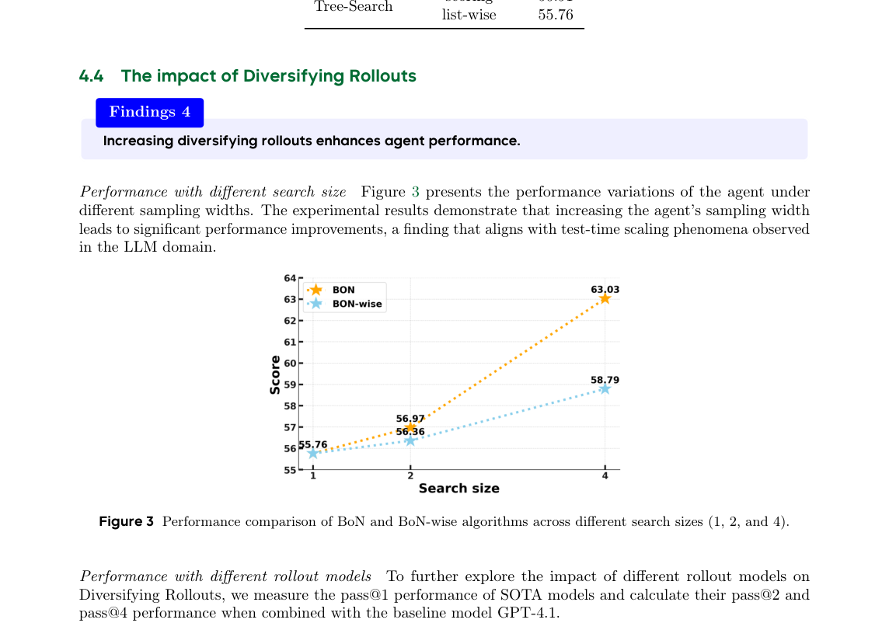
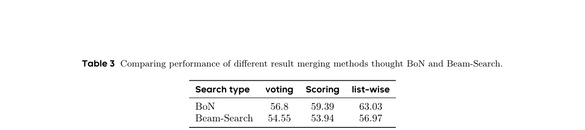

# Scaling Test-time Compute for LLM Agents

这篇论文研究 agent 的 test-time scaling。agent rollout 包含代码、工具调用和中间决策，早期分叉会改变后续成本。因此预算不能只按单次回答的 `best-of-N` 分配。

---

## 1. 计算预算插入点

图中把 agent test-time scaling 分成四类：parallel sampling、sequential revision、verifier/result merging 和 diversified rollouts。区别在于额外计算插入到轨迹的哪个位置。

* **parallel sampling：** 一次生成多条完整 rollout。输入是同一个任务状态，输出是多个候选轨迹。代价随 rollout 数线性上升。

* **sequential revision：** 在一条轨迹内部触发反思或局部修订。输入是中间状态和错误信号，输出是修订后的后续动作。

* **verifier/result merging：** 多条轨迹完成后再排序、打分或合并。输入是候选结果集合，输出是最终答案或合成结果。

* **diversified rollouts：** 在采样早期增加差异，避免多条轨迹进入同一路径。输入是采样策略或 prompt 变体，输出是更分散的候选集合。

核心问题是：额外计算是否转化为更好的候选覆盖和更准确的选择。只增加 rollout 数量不保证成功率线性上升。

## 2. BoN 和 BoN-wise 的宽度收益

论文以 `GPT-4.1` agent 为 baseline，整体得分为 `55.76`。`BoN` 在 search size 4 时达到 `63.03`，约提高 8 分。

图中横轴是 search size `1/2/4`，纵轴是 agent score。`BoN` 从 `55.76` 提升到 `56.97` 再到 `63.03`；BoN-wise 从 `55.76` 提升到 `56.36` 再到 `58.79`。

这个结果说明 parallel sampling 有收益，但收益依赖候选生成方式。BoN-wise 没有在 search size 4 达到 BoN 的提升幅度，说明“把预算分摊到轨迹局部”不一定优于完整候选集合。

## 3. 结果合并比投票更关键

表中比较 voting、独立 scoring 和 list-wise。`BoN` 的三种结果分别为 `56.80`、`59.39` 和 `63.03`；Beam-Search 的三种结果分别为 `54.55`、`53.94` 和 `56.97`。list-wise verifier 在两种搜索策略上都更好。

这个结果对应第 1 节的 verifier/result merging 路线。候选之间的相对比较是 test-time compute 的一部分。直接投票会丢掉候选质量差异，独立 scoring 也可能无法处理候选间的相对优劣。

## 4. 和端侧 agent 的关系

这篇论文不解决 `NPU`、`flash` 或热管理，但它会改变端侧 agent 的预算模型。

* parallel sampling 增加并发 rollout，会放大端侧推理压力。

* sequential revision 增加单条轨迹长度，会拉长用户可见 latency。

* verifier/result merging 需要额外模型调用或判别器，会占用后台窗口。

* diversified rollouts 可能提高成功率，但也会增加工具调用和环境交互次数。

如果把它和 `Agent.xpu` 连起来看，`reactive flow` 更适合小规模 verifier 或短 revision；`proactive flow` 可以在 slack window 里做多 rollout 或结果合并。

## 5. 局限

* 收益依赖模型、agent benchmark、工具环境和 verifier。论文中的排序不能直接外推到所有 agent。

* 轨迹越长，额外采样与反思成本越高。端侧设备上还要考虑温度和电池。

* verifier 偏好失准时，更多候选可能只放大错误排序。

* TODO: 补各 benchmark 的完整名称、任务类型和预算配置，便于和端侧 agent 的时延约束对齐。

## 参考文献

1. OPPO AI Agent Team, "Scaling Test-time Compute for LLM Agents", arXiv 2025. https://arxiv.org/abs/2506.12928
