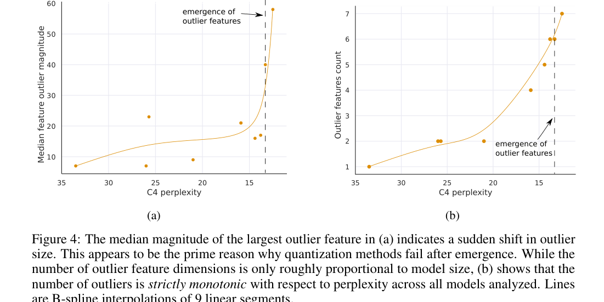
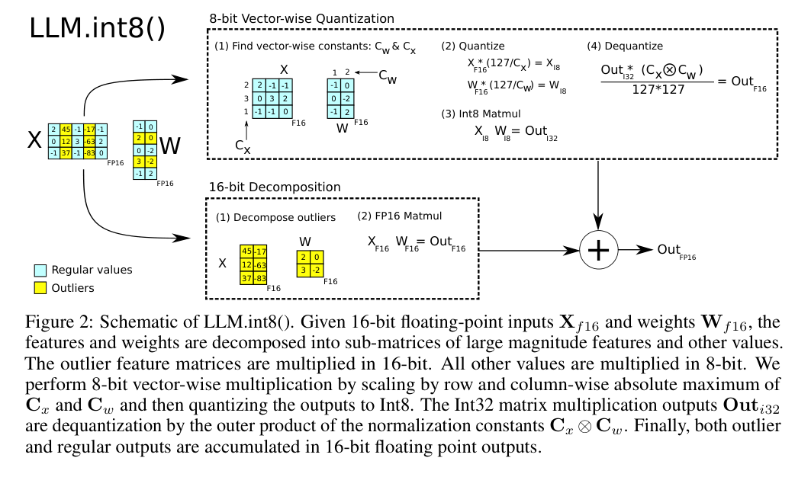
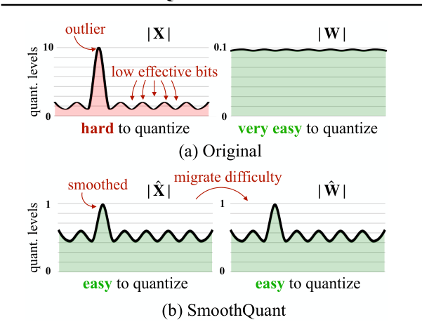
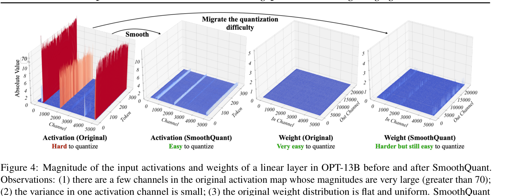
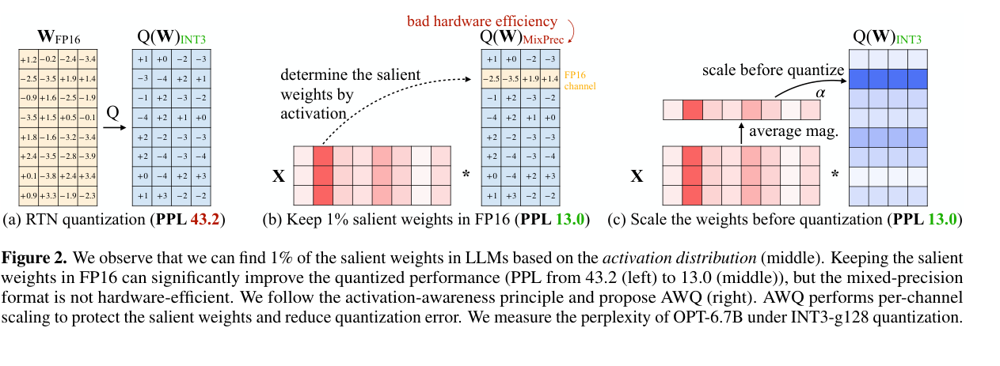
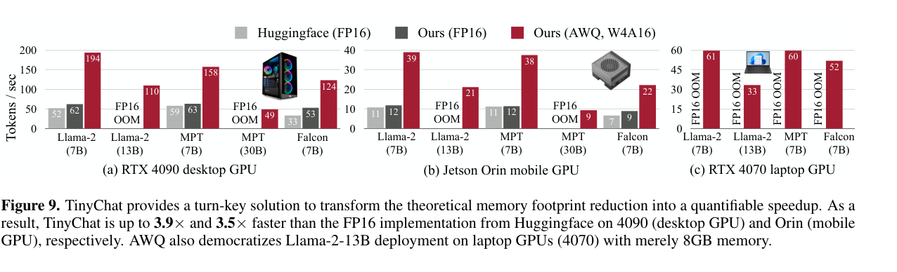

# LLM 量化技术深度解析

这几篇论文都在处理 LLM 推理里的同一个问题：参数和 activation 都太大，直接低比特量化又会被少数异常通道、量化尺度和硬件 kernel 卡住。`LLM.int8()` 先解释为什么大模型 8-bit 会失效，`SmoothQuant` 把 activation 难点迁移到 weight，`AWQ` 则把端侧 weight-only 量化的关键压到少量重要通道上。

## 1. Activation outlier 与 INT8 失效

### 1.1 LLM.int8(): 8-bit Matrix Multiplication for Transformers at Scale

论文解决的是一个很具体的问题：为什么小模型上可用的 `INT8` 矩阵乘，在模型规模变大后会突然失效。

- **主要动机：** 常规 8-bit 量化默认张量里的数值范围比较平滑，但大模型 hidden state 里会出现极少数幅值很大的 `outlier feature`。这些维度数量不多，却会把量化范围拉宽，让大多数普通值只剩很少有效 bit。

- **数据现象：** 论文把 outlier 和模型能力放在一起看，发现当 C4 perplexity 降到某个区间后，最大 outlier 幅值会突然上升，outlier feature 数量也随 perplexity 变好而单调增加。正文里还提到，在 `6.7B` 模型上大约有 `150k` 个 outlier features，但集中在约 `6` 个 hidden dimensions；把这些维度移除会让 attention top-1 概率从约 `40%` 降到约 `20%`，perplexity 恶化 `600%-1000%`。

这张图的作用不是展示“有 outlier”这么简单，而是说明量化失败和模型规模/能力之间存在相变：模型越强，少数异常维度越大，常规 absmax 量化越容易把正常值压扁。

- **核心方法：** `LLM.int8()` 做了两条路径。普通值仍然走 row/column 级别的 `vector-wise quantization`，用 `INT8` 乘法得到 `INT32` 输出后再反量化；超过阈值的 outlier 维度被单独拆出来，保留 `FP16` 路径计算，最后把两条路径的结果加回去。

这里的核心点是：它不是强行把所有值都塞进 `INT8`，而是承认少数 outlier 对模型输出非常关键，把精度预算集中留给这些维度。

- **主要实验：** 论文在 OPT 系列从 `125M` 到 `175B` 的规模上测试 C4 perplexity 和 zero-shot accuracy，结论是 `LLM.int8()` 在大模型上能保持接近 16-bit 的效果；同时模型显存大约压到原来的 `1/2`。相比之下，普通 absmax 或 zero-point 在大模型区间会明显失稳。

- **个人感觉 / 局限：** 这篇最有价值的是解释“大模型 INT8 为什么坏”，方法本身其实带了一个工程代价：outlier 需要单独 `FP16` 路径，所以它不是完全规整的 `INT8 GEMM`。如果目标是吃满硬件整数 kernel，后面 `SmoothQuant` 这类把图重新变规则的方法会更自然。

## 2. W8A8 的量化难度迁移

### 2.1 SmoothQuant: Accurate and Efficient Post-Training Quantization for Large Language Models

`SmoothQuant` 关心的是另一层问题：如果只压 weight，显存会下降，但核心矩阵乘法不一定能落到高效 `W8A8` kernel；如果 activation 也量化，outlier 又会让精度崩掉。

- **主要动机：** `LLM.int8()` 用 mixed-precision decomposition 解决准确率，但这种拆 outlier 的路径对硬件不够规整。`SmoothQuant` 想要的是训练后量化，不做反向传播，同时让 weight 和 activation 都能进入 `INT8 GEMM`。

- **数据现象：** 论文的出发点是 activation 和 weight 的量化难度不对称：activation 里少数 outlier 会撑大整个量化范围，导致普通值有效 bit 很少；weight 分布相对平坦，通常更容易量化。

这张图其实就是 `SmoothQuant` 的核心动机：不是所有张量都一样难量化，真正难的是 activation 的通道峰值。

- **核心方法：** 论文利用线性层等价变换，把 activation 的难度迁移到 weight 上：
  $$Y = XW = (X\operatorname{diag}(s)^{-1})(\operatorname{diag}(s)W) = \hat{X}\hat{W}$$
  其中 $s_j = \max(|X_j|)^\alpha / \max(|W_j|)^{1-\alpha}$。$s_j$ 按通道缩小 activation 的异常峰值，同时反向放大对应 weight 通道。由于这个缩放可以离线融合到前一层参数里，推理时仍然是规则的线性层。

这张图里最关键的是左侧 `Activation (Original)` 的大尖峰被压平，而右侧 `Weight (SmoothQuant)` 虽然变难了一点，但仍然相对可量化。也就是说，论文不是消灭量化误差，而是在 activation 和 weight 之间重新分配误差。

- **主要实验：** 论文在 OPT-175B、BLOOM-176B、GLM-130B、MT-NLG 530B 等模型上验证 `W8A8`，报告能维持接近原模型的精度。系统侧在 FasterTransformer 上最高达到约 `1.56x` 加速和接近 `2x` 显存节省；对于 MT-NLG 530B，也能把服务需要的 GPU 数量压下来。

- **个人感觉 / 局限：** `SmoothQuant` 的优点是工程路径很干净，适合真正走 `INT8 GEMM`。但这里的 $\alpha$ 本质上是迁移强度，过小 activation 仍然难量化，过大 weight 端会变差，所以它依赖校准数据和每类模型的 sweet spot。

## 3. Weight-only 低比特与重要通道保护

### 3.1 AWQ: Activation-aware Weight Quantization for LLM Compression and Acceleration

`AWQ` 把场景放到端侧和边缘设备：activation 运行时量化会引入额外开销，真正好落地的是 `weight-only quantization`，但低比特 weight-only 的精度损失很容易集中爆发。

- **主要动机：** 如果模型要放到手机、Jetson 或消费级 GPU 上，模型权重是最直接的显存压力。`INT4/INT3` weight-only 可以显著压缩模型，但普通 RTN 会让 perplexity 明显变差。

- **数据现象：** 论文发现权重并不是同等重要。只保留约 `0.1%-1%` 的 salient weights 就能显著改善低比特量化效果，而且这些重要通道应该从 activation magnitude 里找，而不是只看 weight norm。图里的 OPT-6.7B 在 `INT3-g128` 下，RTN 的 PPL 是 `43.2`，如果把 1% salient weights 保持 `FP16`，PPL 能降到 `13.0`。

这张图说明了两个点：第一，activation 分布能指出哪些 weight 通道更重要；第二，直接混合精度虽然有效，但硬件效率差，所以需要把“保护重要通道”改写成纯量化友好的形式。

- **核心方法：** `AWQ` 不保留混合精度通道，而是在量化前做 per-channel scaling。直觉上是放大 salient channel，让它在量化后相对误差更小；同时通过小规模 grid search 选择每层缩放强度。整个过程不做 reconstruction，也不需要反向传播。

- **主要实验：** 论文在 LLaMA、Llama-2、Mistral、Mixtral、Code Llama 和多模态模型上比较 RTN、GPTQ 和 AWQ。系统侧配合 `TinyChat` 后，论文报告在 RTX 4090 上相对 HuggingFace FP16 最高约 `3.9x`，在 Jetson Orin 上最高约 `3.5x`；图里也能看到 Llama-2-13B 在部分 FP16 设置下 OOM，但 `AWQ W4A16` 可以跑起来。

这张图是 `AWQ` 比较重要的系统证据：它不是只在 perplexity 表格上好看，而是配合 kernel 后能把 weight-only 的理论显存收益转成 token/s。

- **个人感觉 / 局限：** `AWQ` 的工程味最重，重点不是“量化误差最优”，而是低比特模型能不能真的在端侧跑起来。限制也在这里：per-channel scaling、packing 和 kernel fusion 都会和硬件后端绑定，换平台后加速幅度不一定能直接迁移。

## 4. 小结

这三篇论文的路线可以串起来看：

- `LLM.int8()` 先指出大模型量化的核心异常现象：少数 outlier dimensions 对输出非常关键，不能粗暴压进同一个 `INT8` 范围。
- `SmoothQuant` 把问题从“保留 outlier 高精度”改成“把 activation 的量化难度迁移到 weight”，让运行时保持规整 `W8A8`。
- `AWQ` 进一步面向端侧 weight-only 场景，用 activation 统计找 salient channel，再用 scaling 保护低比特下最敏感的权重。

个人感觉，量化论文里最值得盯的不是 bit 数本身，而是量化误差到底集中在哪里：`activation outlier`、通道尺度、salient weights、kernel 访存，这些决定了方法能不能从论文表格走到真实推理系统。

## 参考文献

1. Dettmers et al., "LLM.int8(): 8-bit Matrix Multiplication for Transformers at Scale", NeurIPS 2022, https://arxiv.org/abs/2208.07339
2. Xiao et al., "SmoothQuant: Accurate and Efficient Post-Training Quantization for Large Language Models", ICML 2023, https://arxiv.org/abs/2211.10438
3. Lin et al., "AWQ: Activation-aware Weight Quantization for LLM Compression and Acceleration", MLSys 2024, https://arxiv.org/abs/2306.00978
