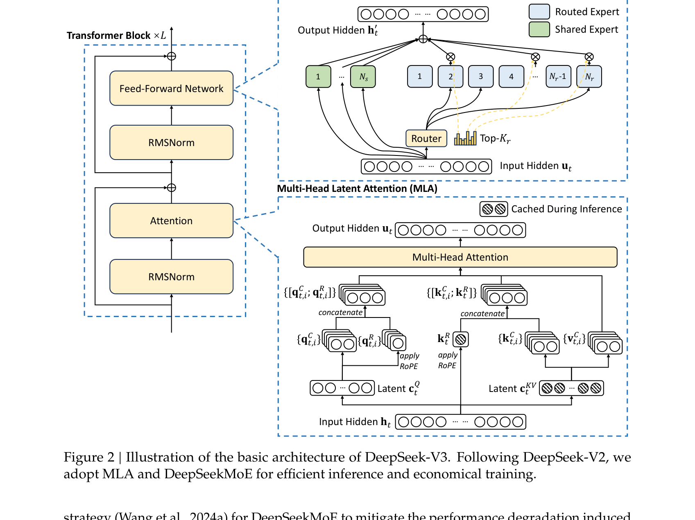
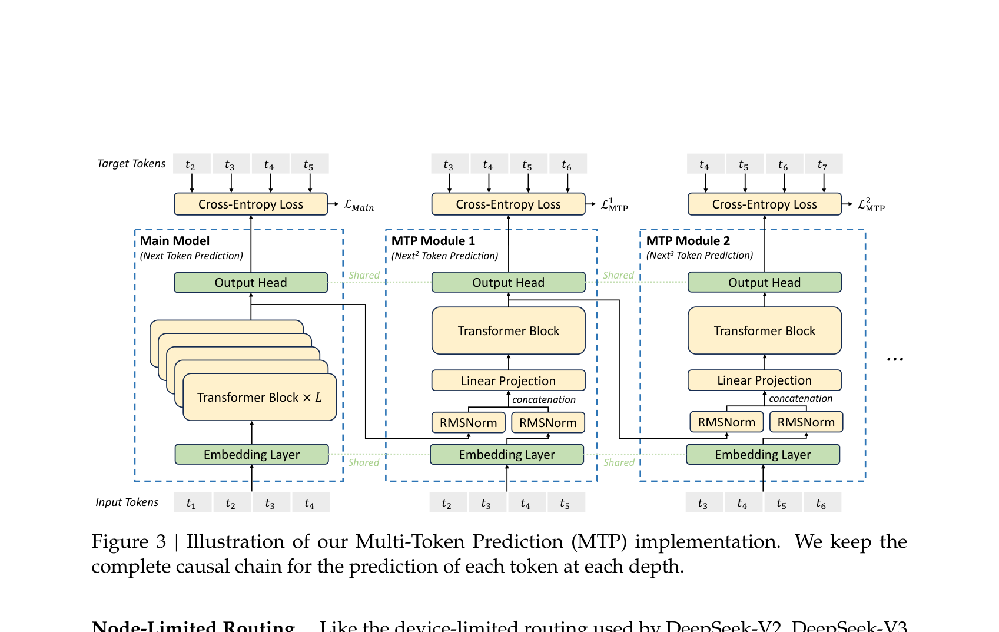
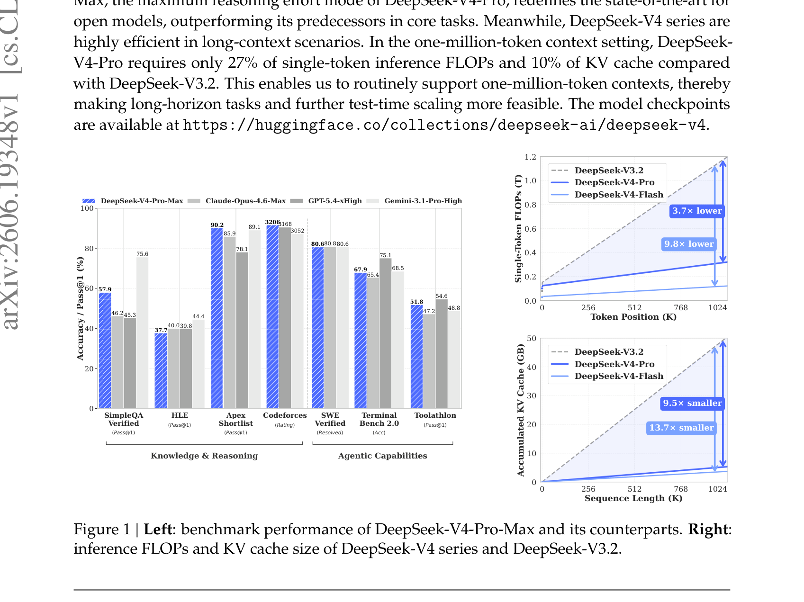
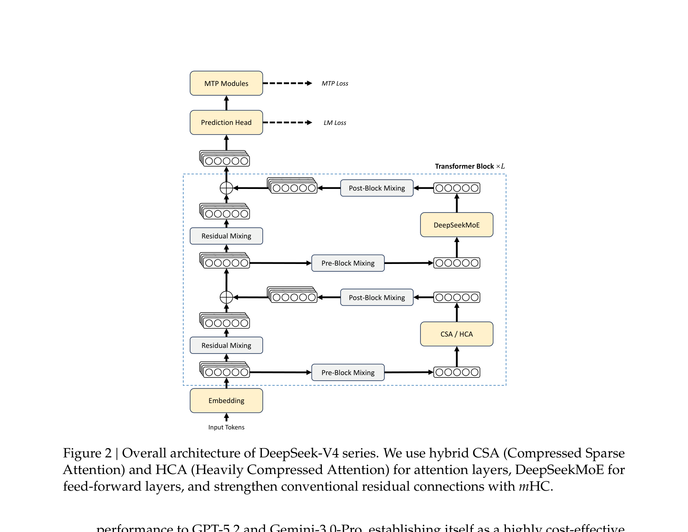
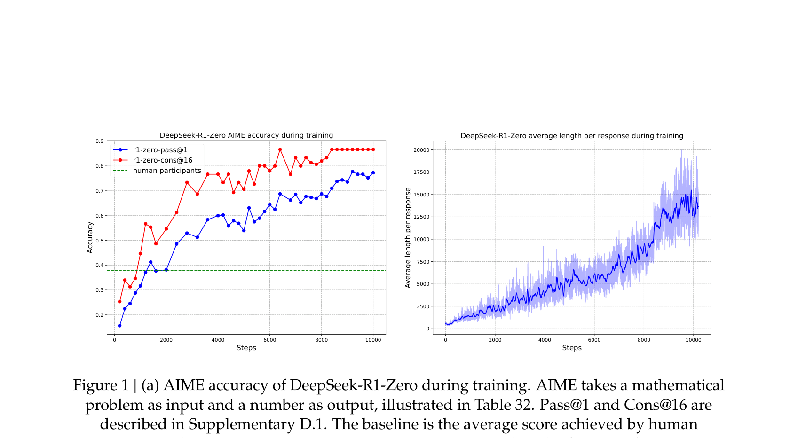
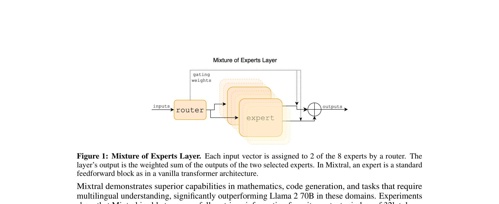
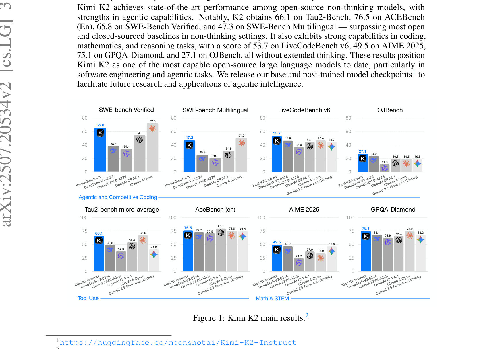
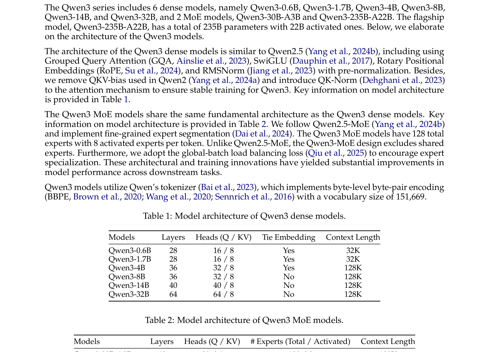
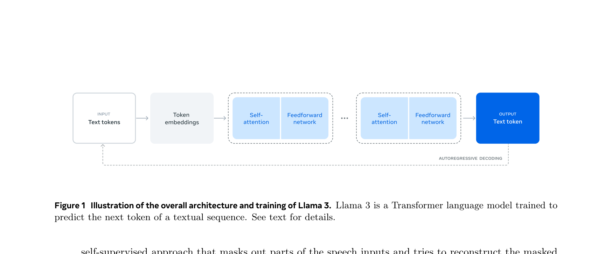
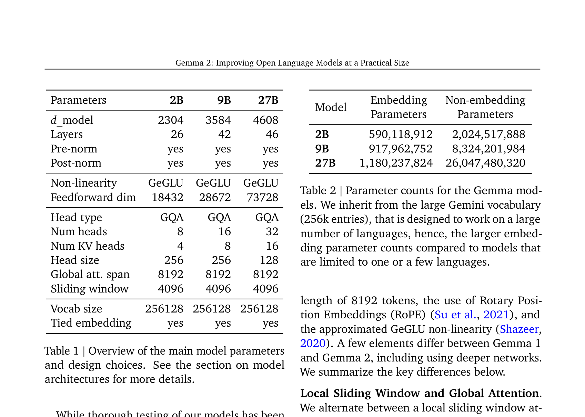

# 厂商模型论文路线笔记

这篇记录主流厂商模型技术报告。本文不按榜单排序，主线是模型报告怎样回答几个工程问题：参数规模怎么扩、每个 `token` 激活多少参数、长上下文的 `KV cache` 怎么压、推理时思考预算怎么控，以及后训练怎样把模型从静态问答推到工具和 agent 任务。

## 1. DeepSeek：从高效 MoE 到百万上下文

### 1.1 DeepSeek-V3 Technical Report

论文提出 `DeepSeek-V3`，一个 `671B` 总参数、每个 `token` 激活 `37B` 参数的 `MoE` 模型。论文的核心价值集中在系统路线：大规模开源模型的训练成本、通信、低精度和推理部署被写在同一个报告里。

- **核心问题：** `MoE` 可以提高总参数量，但训练会被 expert 负载均衡、跨节点 `all-to-all` 通信和推理时 `KV cache` 成本卡住。
- **模型结构：** DeepSeek-V3 采用 `MLA` 压缩注意力状态，用 `DeepSeekMoE` 控制每个 token 的 active 参数，并用 auxiliary-loss-free balancing 避免把负载均衡损失直接压到主任务目标上。

图中显示主干仍是 decoder-only Transformer，但 attention 路径用 `MLA` 降低 KV 存储，FFN 路径进入 `DeepSeekMoE`。`token` 的计算在路由后只激活部分 expert，这使训练和推理成本跟总参数量解耦。

- **训练策略：** 论文预训练使用 `14.8T` tokens，之后接 `SFT` 和 `RL`。训练系统侧报告完整训练只用了 `2.788M H800 GPU hours`，并且没有不可恢复的 loss spike 或 rollback。这个数字的作用是说明方法收益来自模型结构和系统实现一起配合，而不是只靠堆更多 GPU。

- **MTP：** `Multi-Token Prediction` 把未来多个 token 的预测目标放进训练，使隐藏状态更适合后续推测解码和多步预测。

图中显示每个预测深度有自己的 MTP module。输入状态从主干隐藏层进入后，模块预测后续位置的 token 分布。这个训练目标给模型增加了未来 token 的局部监督，但推理时仍要处理额外 head 和训练-推理路径是否一致的问题。

- **实验结果：** 摘要图中，DeepSeek-V3 在 MMLU-Pro、GPQA-Diamond、MATH 500、AIME 2024、Codeforces 和 SWE-bench Verified 上与开闭源强模型比较。图里 DeepSeek-V3 的 MMLU-Pro 为 `75.9`，GPQA-Diamond 为 `59.1`，MATH 500 为 `90.2`，SWE-bench Verified 为 `42.0`。

- **局限：** 这类报告给出了系统级训练成本，但高质量数据构造、后训练细节和线上推理策略仍难完整复现。对外部复现者来说，`MoE` 路由、FP8、通信重叠和 kernel 实现是同一个系统问题，不能只复刻模型配置。

### 1.2 DeepSeek-V4: Towards Highly Efficient Million-Token Context Intelligence

`DeepSeek-V4` 是 DeepSeek-AI 在 2026 年 4 月发布的 preview 技术报告。论文给出两个 `MoE` 模型：`DeepSeek-V4-Pro` 为 `1.6T` 总参数、`49B` active 参数；`DeepSeek-V4-Flash` 为 `284B` 总参数、`13B` active 参数。两者都支持 `1M` tokens 上下文。

- **核心问题：** 长上下文模型的瓶颈不只在训练长度。解码阶段每步都要读历史 `KV cache`，当上下文到几十万或百万 token 时，单 token FLOPs 和 KV 存储会让推理成本随长度变得不可接受。

图右侧直接给出长上下文代价：在 `1M` token setting 下，论文报告 `DeepSeek-V4-Pro` 相比 `DeepSeek-V3.2` 只需要 `27%` 的 single-token inference FLOPs 和 `10%` 的 `KV cache`。这个图把设计约束写得很清楚：长上下文模型必须同时压 attention 计算和 KV 存储，单独扩 RoPE 或训练长度不够。

- **核心方法：** 论文提出混合注意力，把 `Compressed Sparse Attention` (`CSA`) 和 `Heavily Compressed Attention` (`HCA`) 结合起来。`CSA` 保留可检索的稀疏上下文，`HCA` 提供更重的压缩路径，目标是让远距离信息进入模型但不让每步 decode 线性扫描全部历史。

图中显示 `CSA` 先对上下文做压缩和稀疏选择，再把被选中的历史状态送入当前 attention。关键点是把百万上下文切成可被索引、压缩和缓存管理的状态。

- **训练与优化：** V4 报告还加入 `mHC` residual connection 和 `Muon` optimizer，并预训练超过 `32T` tokens。`mHC` 改的是层间信息混合，`Muon` 改的是大规模训练收敛与稳定性。

- **局限：** 论文是 preview 报告，很多对比依赖同一报告中的评测协议。长上下文结果还需要看真实检索任务、agent trace 和高并发 serving 下的成本，而不仅是单请求上下文长度。

### 1.3 DeepSeek-R1: Incentivizing Reasoning Capability in LLMs via Reinforcement Learning

`DeepSeek-R1` 把 DeepSeek-V3 的基座能力转成 reasoning 能力。论文的核心问题是：复杂推理是否一定要依赖人工标注的长链路推理轨迹。

- **核心方法：** `DeepSeek-R1-Zero` 直接从 base model 开始做 `GRPO`，奖励只基于最终答案是否正确，不强制模仿人类推理过程。随后 `DeepSeek-R1` 用多阶段流程补可读性和通用能力，包括 rejection sampling、SFT 和 RL。

图中显示随着 RL 推进，AIME accuracy 和平均 response length 同时上升。这个现象说明 RL 同时影响答案校准和模型在推理时分配计算预算的方式。

- **局限：** R1 证明了最终答案奖励能诱导 reasoning pattern，但这种训练也带来语言混合、可读性和 reward domain 偏置问题。论文后续仍需要 SFT 和多阶段后训练来把 reasoning 能力接回通用助手能力。

## 2. MoE 路线：更大总参数与更低 active 成本

### 2.1 Mixtral of Experts

`Mixtral 8x7B` 是较早把开源 `MoE` 路线做成强基线的模型。论文把 dense FFN 替换成 `8` 个 expert，每层每个 token 由 router 选择 `2` 个 expert。

- **模型结构：** Mixtral 每个 token 可访问 `47B` 参数，但推理只使用 `13B` active 参数。上下文长度为 `32K` tokens，模型在多个 benchmark 上达到或超过 Llama 2 70B 和 GPT-3.5。

图中显示 router 对输入向量分配 top-2 experts，两个 expert 的输出加权求和后回到主干。这个结构的设计约束是 router 必须稳定，expert 负载必须均衡，否则理论 active 参数优势会被通信或热点 expert 吃掉。

- **局限：** Mixtral 的意义是证明 sparse MoE 可以成为开源强基线，但它还没有处理后来的 reasoning mode、百万上下文和 agent 后训练问题。它更像后续 DeepSeek/Qwen/Kimi MoE 报告的结构起点。

### 2.2 Kimi K2 Technical Report

`Kimi K2` 关注 agentic intelligence。论文报告模型为 `1.04T` 总参数、`32B` active 参数的 `MoE` LLM，使用 `MuonClip` optimizer，在 `15.5T` tokens 上完成预训练并报告没有 loss spike。

- **核心问题：** agent 任务需要代码、工具调用、多步计划和环境交互。静态 imitation data 很难覆盖这些轨迹，后训练必须构造更结构化的 agentic 经验。

图中结果集中在 agentic 和 competitive coding：摘要报告 `SWE-Bench Verified` 为 `65.8`，`SWE-Bench Multilingual` 为 `47.3`，`LiveCodeBench v6` 为 `53.7`，`Tau2-Bench` 为 `66.1`，`ACEBench (En)` 为 `76.5`。这些指标说明 K2 的模型报告把工具与代码任务作为主线。

- **训练策略：** `MuonClip` 在 `Muon` 基础上加入 `QK-Clip`，目标是保留 token-efficient optimizer 的收敛优势，同时处理 attention `QK` 相关的训练不稳定。

- **局限：** agentic 能力很依赖合成任务、环境反馈和后训练数据。报告给出 optimizer 与结果，但外部很难完整复现 agent 数据管线。

### 2.3 Qwen3 Technical Report

`Qwen3` 把模型族做成 dense 和 `MoE` 两条线，参数规模从 `0.6B` 到 `235B`。旗舰 `Qwen3-235B-A22B` 是 `235B` 总参数、`22B` active 参数的 MoE 模型。

- **核心问题：** reasoning 模型和普通 chat 模型分开部署会带来切换成本。Qwen3 把 thinking mode 和 non-thinking mode 放进同一个模型，并提供 thinking budget 控制推理时计算。

图中列出 dense 和 MoE 两类模型配置。论文摘要还说明 Qwen3 预训练使用 `36T` tokens，并把多语言覆盖从 `29` 扩到 `119` 种语言和方言。

- **局限：** thinking budget 把一部分模型能力控制权交给推理侧。真实系统需要知道什么时候开 thinking、开多长、如何避免无效长推理；论文没有给出对所有任务通用的预算策略。

## 3. Dense 与 practical-size 路线

### 3.1 The Llama 3 Herd of Models

`Llama 3` 报告选择稳定的 dense Transformer 路线，而不是 MoE。最大模型为 `405B` 参数，支持 `128K` context。论文报告旗舰模型用 `15.6T` text tokens 预训练，训练 FLOPs 为 `3.8×10^{25}`。

- **核心方法：** Meta 把主要变量写成 data、scale、managing complexity。架构上保持 dense Transformer，后训练使用 `SFT`、rejection sampling 和 `DPO`。这种设计牺牲 active 参数效率，但降低了大规模训练和发布时的系统复杂度。

图中把 Llama 3 的开发流程拆成预训练、后训练、安全模型和多模态实验。它说明 Llama 3 的影响力来自一套模型族和发布体系，而不是单个结构创新。

- **局限：** Dense 405B 的推理成本很高。论文给出强模型和完整 release，但训练数据、过滤细节和后训练数据无法被外部完全复现。

### 3.2 Gemma 2: Improving Open Language Models at a Practical Size

`Gemma 2` 走 practical-size 路线，模型规模为 `2B`、`9B`、`27B`。论文关注的问题是：小模型继续增加训练 token 的收益变慢后，是否能用更丰富的训练目标提升每一步的信息量。

- **模型结构：** Gemma 2 使用 local-global attention 交替、`GQA`、GeGLU 等结构。`2B` 和 `9B` 模型用知识蒸馏训练，`27B` 从头训练。

图中显示三个模型的层数、hidden size、attention heads 和 KV heads。小模型主要在标准 Transformer 上加入更适合推理成本的局部/全局 attention 与蒸馏目标。

- **局限：** Gemma 2 的目标是 practical size，不是开放模型 frontier 的最大规模。它适合看小模型训练目标和部署成本，不适合代表 MoE 或长上下文系统路线。

## 4. 闭源报告的短覆盖

### 4.1 GPT-4 Technical Report

`GPT-4 Technical Report` 仍是影响力很大的模型报告，但它没有公开参数量、训练 tokens、模型结构和数据构造细节。它的主要价值是评测、安全和能力边界记录，而不是可复现的结构路线。

- **短覆盖原因：** 这篇报告适合做能力基线，不适合作为架构卡片。本文不为它补图，原因是论文图表主要服务 benchmark 和 safety 分析，不能支撑模型结构或训练机制解释。

- **局限：** 闭源报告的评测结论可以作为外部参照，但不能回答“为什么这个结构有效”或“复现时应该改哪一层”。

## 5. 小结

- `DeepSeek-V3/V4` 把 MoE、低精度训练、长上下文 attention 和推理系统绑在一起看，重点是 active 参数和 `KV cache` 成本。
- `Mixtral/Qwen3/Kimi K2` 说明 MoE 已经从结构实验变成主流模型族方案，但每篇论文的主问题不同：Mixtral 关注 sparse MoE 基线，Qwen3 关注 thinking mode 统一，Kimi K2 关注 agentic 后训练。
- `Llama 3/Gemma 2` 说明 dense 和 small practical models 仍然重要。前者强调稳定大规模 release，后者强调小模型训练信号质量。
- 闭源模型报告适合当能力参照，不能替代可复现技术报告。后续补模型论文时，需要优先看是否公开结构、训练 token、active 参数、后训练流程和真实系统成本。

## 参考文献

1. DeepSeek-AI, "DeepSeek-V3 Technical Report", arXiv 2025, https://arxiv.org/abs/2412.19437
2. DeepSeek-AI, "DeepSeek-V4: Towards Highly Efficient Million-Token Context Intelligence", arXiv 2026, https://arxiv.org/abs/2606.19348
3. DeepSeek-AI, "DeepSeek-R1: Incentivizing Reasoning Capability in LLMs via Reinforcement Learning", arXiv 2026, https://arxiv.org/abs/2501.12948
4. Jiang et al., "Mixtral of Experts", arXiv 2024, https://arxiv.org/abs/2401.04088
5. Moonshot AI, "Kimi K2 Technical Report", arXiv 2026, https://arxiv.org/abs/2507.20534
6. Qwen Team, "Qwen3 Technical Report", arXiv 2025, https://arxiv.org/abs/2505.09388
7. Llama Team, "The Llama 3 Herd of Models", arXiv 2024, https://arxiv.org/abs/2407.21783
8. Gemma Team, "Gemma 2: Improving Open Language Models at a Practical Size", arXiv 2024, https://arxiv.org/abs/2408.00118
9. OpenAI, "GPT-4 Technical Report", arXiv 2023, https://arxiv.org/abs/2303.08774
